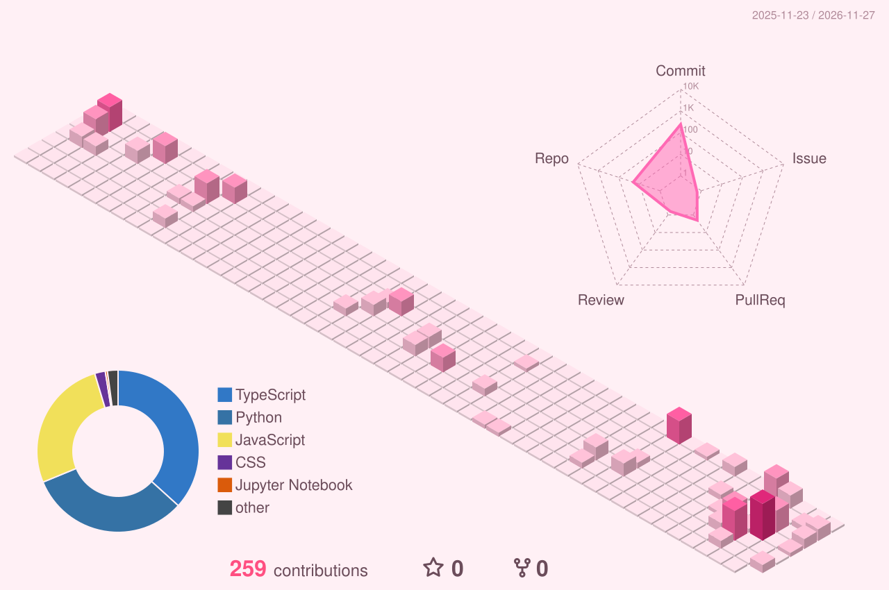

<!-- ═══════════════════════════════  HERO  ═══════════════════════════════ -->
<div align="center">

<a href="https://portfolio-v2-rosy-eight.vercel.app/">
  
</a>

<br/><br/>

<a href="https://www.linkedin.com/in/angela-lopez03"></a>
<a href="mailto:angelalopezoliva03@gmail.com"></a>
<a href="https://portfolio-v2-rosy-eight.vercel.app/"></a>


</div>

<br/>

<!-- ═══════════════════════════════  INTRO  ═══════════════════════════════ -->
<table>
<tr>
<td>

### 💌 Nice to meet you

I'm a **software engineer who thinks like a product person**. I love taking a messy real-world process, sitting down with the people who live it every day, and turning it into software that feels simple — then shipping it end-to-end, from the first Figma frame to production.

Right now I'm a **Logistics & Digitalization Trainee at Airbus**, where I get to see first-hand how digital tools change the way planes are built and supplied. In parallel I'm finishing two master's degrees — one in **web application development** and one in **organizational management & data analytics** — because I believe the best engineers understand both the code *and* the business around it.

I'm looking for **Product Engineer** opportunities where software meets real operations, and where data & AI are used to solve real problems — not just for the buzzword. 🌸

</td>
</tr>
</table>


<!-- ═══════════════════════════════  3D ROOM  ═══════════════════════════════ -->
<p align="center"></p>

<h2 align="center">🌙 Step into my 3D room</h2>

<p align="center">
  <a href="https://portfolio-v2-rosy-eight.vercel.app/">
    
  </a>
  <br/>
  <sub>My CV lives in a cozy bedroom at night, hand-coded in <b>Three.js</b>. Open the diary, the laptop or the corkboard to explore.</sub>
  <br/><br/>
  <a href="https://portfolio-v2-rosy-eight.vercel.app/"></a>
</p>

<!-- ═══════════════════════════════  WHAT I BRING  ═══════════════════════════════ -->
<p align="center"></p>

<h2 align="center">✨ What I bring</h2>

<table align="center">
<tr>
<td width="33%" align="center" valign="top">
<br/>

<h3>Full-stack engineering</h3>
<sub>Robust backends in <b>Java / Spring</b> and <b>Node</b>, modern frontends in <b>Angular</b> & <b>React</b>, clean REST APIs and solid data models.</sub>
<br/><br/>
</td>
<td width="33%" align="center" valign="top">
<br/>

<h3>Product & design</h3>
<sub>Certified in <b>Figma UI/UX</b>. I care about the <i>why</i> before the <i>how</i>: user needs, clear flows, details that feel good.</sub>
<br/><br/>
</td>
<td width="33%" align="center" valign="top">
<br/>

<h3>Data & operations</h3>
<sub>Hands-on with <b>logistics & supply chain</b> at Airbus and trained in <b>data analytics</b> — I speak both engineer and business.</sub>
<br/><br/>
</td>
</tr>
</table>

<!-- ═══════════════════════════════  JOURNEY  ═══════════════════════════════ -->
<p align="center"></p>

<h2 align="center">🗺️ My journey</h2>

<div align="center">

| | | |
|:--:|:--|--:|
| ✈️ | **Logistics & Digitalization Trainee** — Airbus Discover Program · Cádiz | `2025 → 2026` |
| 🎓 | **MSc Web Application Development** — Universidad Europea | `2025 → 2026` |
| 📈 | **Master's in Organizational Management & Data Analytics** — UCJC | `2025 → 2026` |
| 🏥 | **Software Consulting & Development Intern** — Dedalus Healthcare · Sevilla | `2025` |
| 🎓 | **BSc Computer Science & Software Engineering** — Universidad de Sevilla | `2021 → 2025` |

</div>

<!-- ═══════════════════════════════  STACK  ═══════════════════════════════ -->
<p align="center"></p>

<h2 align="center">🛠️ Toolbox</h2>

<p align="center">
  <a href="https://skillicons.dev">
    <picture><source media="(prefers-color-scheme: dark)" srcset="https://skillicons.dev/icons?i=java,spring,nodejs,express,python,fastapi,django,flask&theme=dark&perline=8"/></picture>
    <br/>
    <picture><source media="(prefers-color-scheme: dark)" srcset="https://skillicons.dev/icons?i=angular,react,ts,js,html,css,sass,threejs&theme=dark&perline=8"/></picture>
    <br/>
    <picture><source media="(prefers-color-scheme: dark)" srcset="https://skillicons.dev/icons?i=postgres,mysql,mongodb,supabase,docker,gcp,githubactions,vercel&theme=dark&perline=8"/></picture>
    <br/>
    <picture><source media="(prefers-color-scheme: dark)" srcset="https://skillicons.dev/icons?i=git,github,jira,figma&theme=dark&perline=8"/></picture>
  </a>
</p>

<p align="center">
  
  
  
  
  
  
  
</p>

<!-- ═══════════════════════════════  PROJECTS  ═══════════════════════════════ -->
<p align="center"></p>

<h2 align="center">💗 Things I've built</h2>

<p align="center"><sub>Click any card to try it live ✨</sub></p>

<table align="center">
<tr>
<td width="50%" align="center" valign="top">
<br/>
<a href="https://portfolio-v2-rosy-eight.vercel.app/"></a>
<h3>🌙 Night Room Portfolio</h3>
<sub><i>My CV, but make it a cozy bedroom</i></sub>
<p>My CV as a 3D bedroom at night: click the diary, laptop or corkboard to explore. Every object is generated in code, no 3D models. ES / EN.</p>


<br/><br/>
<a href="https://portfolio-v2-rosy-eight.vercel.app/"></a>
<a href="https://github.com/angelalop03/Landing_Page"></a>
<br/><br/>
</td>
<td width="50%" align="center" valign="top">
<br/>
<a href="https://bellas-heart.vercel.app/"></a>
<h3>💔 Bella's Heart</h3>
<sub><i>A visual novel about gender-based violence</i></sub>
<p>You play as Bella: each choice shifts her feelings and the relationship, across 4 endings that teach you to spot red flags. Born as my BSc thesis.</p>


<br/><br/>
<a href="https://bellas-heart.vercel.app/"></a>
<a href="https://github.com/angelalop03/bellas-heart-web"></a>
<br/><br/>
</td>
</tr>
<tr>
<td width="50%" align="center" valign="top">
<br/>
<a href="https://isla-mochi.vercel.app/"></a>
<h3>🏝️ Isla Mochi</h3>
<sub><i>Your cycle, as the seasons of a tiny island</i></sub>
<p>A code-only 3D Mochi tells you how you may feel in each phase of your cycle and what can help, with privacy-first AI tips and chat. Day & night modes.</p>


<br/><br/>
<a href="https://isla-mochi.vercel.app/"></a>
<a href="https://github.com/angelalop03/MochiTracker"></a>
<br/><br/>
</td>
<td width="50%" align="center" valign="top">
<br/>
<a href="https://ludika-t.vercel.app/"></a>
<h3>🧸 LudikaT</h3>
<sub><i>A real client: childcare & party business</i></sub>
<p>Website for a real childcare & party business: a pastel 3D landing, a booking calendar with email alerts for the team and a private admin panel.</p>


<br/><br/>
<a href="https://ludika-t.vercel.app/"></a>
<a href="https://github.com/angelalop03/LudikaT"></a>
<br/><br/>
</td>
</tr>
</table>

<!-- ═══════════════════════════════  3D HEART  ═══════════════════════════════ -->
<p align="center"></p>

<h2 align="center">🕹️ Spin my heart</h2>

<p align="center"><sub>A real 3D model generated in code, rendered right here by GitHub. <b>Drag to rotate · scroll to zoom</b> 💗</sub></p>

```stl
solid heart
facet normal -0.94 0.13 -0.33
outer loop
vertex 0 0 -9
vertex 0 4.6 -7.2
vertex 0.1 5.3 -7.2
endloop
endfacet
facet normal -0.99 0.14 -0.09
outer loop
vertex 0 4.6 -7.2
vertex 0.1 6.8 -5.4
vertex 0.1 5.3 -7.2
endloop
endfacet
facet normal -0.99 0.14 -0.09
outer loop
vertex 0 4.6 -7.2
vertex 0 5.8 -5.4
vertex 0.1 6.8 -5.4
endloop
endfacet
facet normal -0.99 0.14 -0.05
outer loop
vertex 0 5.8 -5.4
vertex 0.2 7.6 -3.6
vertex 0.1 6.8 -5.4
endloop
endfacet
facet normal -0.99 0.14 -0.05
outer loop
vertex 0 5.8 -5.4
vertex 0 6.5 -3.6
vertex 0.2 7.6 -3.6
endloop
endfacet
facet normal -0.99 0.14 -0.03
outer loop
vertex 0 6.5 -3.6
vertex 0.2 8.1 -1.8
vertex 0.2 7.6 -3.6
endloop
endfacet
facet normal -0.99 0.14 -0.03
outer loop
vertex 0 6.5 -3.6
vertex 0 6.9 -1.8
vertex 0.2 8.1 -1.8
endloop
endfacet
facet normal -0.99 0.14 -0.01
outer loop
vertex 0 6.9 -1.8
vertex 0.2 8.2 0
vertex 0.2 8.1 -1.8
endloop
endfacet
facet normal -0.99 0.14 -0.01
outer loop
vertex 0 6.9 -1.8
vertex 0 7 0
vertex 0.2 8.2 0
endloop
endfacet
facet normal -0.99 0.14 0.01
outer loop
vertex 0 7 0
vertex 0.2 8.1 1.8
vertex 0.2 8.2 0
endloop
endfacet
facet normal -0.99 0.14 0.01
outer loop
vertex 0 7 0
vertex 0 6.9 1.8
vertex 0.2 8.1 1.8
endloop
endfacet
facet normal -0.99 0.14 0.03
outer loop
vertex 0 6.9 1.8
vertex 0.2 7.6 3.6
vertex 0.2 8.1 1.8
endloop
endfacet
facet normal -0.99 0.14 0.03
outer loop
vertex 0 6.9 1.8
vertex 0 6.5 3.6
vertex 0.2 7.6 3.6
endloop
endfacet
facet normal -0.99 0.14 0.05
outer loop
vertex 0 6.5 3.6
vertex 0.1 6.8 5.4
vertex 0.2 7.6 3.6
endloop
endfacet
facet normal -0.99 0.14 0.05
outer loop
vertex 0 6.5 3.6
vertex 0 5.8 5.4
vertex 0.1 6.8 5.4
endloop
endfacet
facet normal -0.99 0.14 0.09
outer loop
vertex 0 5.8 5.4
vertex 0.1 5.3 7.2
vertex 0.1 6.8 5.4
endloop
endfacet
facet normal -0.99 0.14 0.09
outer loop
vertex 0 5.8 5.4
vertex 0 4.6 7.2
vertex 0.1 5.3 7.2
endloop
endfacet
facet normal -0.94 0.13 0.33
outer loop
vertex 0 0 9
vertex 0.1 5.3 7.2
vertex 0 4.6 7.2
endloop
endfacet
facet normal -0.70 0.24 -0.68
outer loop
vertex 0 0 -9
vertex 0.1 5.3 -7.2
vertex 0.8 7.4 -7.2
endloop
endfacet
facet normal -0.92 0.32 -0.24
outer loop
vertex 0.1 5.3 -7.2
vertex 1.1 9.5 -5.4
vertex 0.8 7.4 -7.2
endloop
endfacet
facet normal -0.92 0.32 -0.24
outer loop
vertex 0.1 5.3 -7.2
vertex 0.1 6.8 -5.4
vertex 1.1 9.5 -5.4
endloop
endfacet
facet normal -0.94 0.32 -0.14
outer loop
vertex 0.1 6.8 -5.4
vertex 1.2 10.6 -3.6
vertex 1.1 9.5 -5.4
endloop
endfacet
facet normal -0.94 0.32 -0.14
outer loop
vertex 0.1 6.8 -5.4
vertex 0.2 7.6 -3.6
vertex 1.2 10.6 -3.6
endloop
endfacet
facet normal -0.94 0.33 -0.08
outer loop
vertex 0.2 7.6 -3.6
vertex 1.3 11.2 -1.8
vertex 1.2 10.6 -3.6
endloop
endfacet
facet normal -0.94 0.33 -0.08
outer loop
vertex 0.2 7.6 -3.6
vertex 0.2 8.1 -1.8
vertex 1.3 11.2 -1.8
endloop
endfacet
facet normal -0.94 0.33 -0.02
outer loop
vertex 0.2 8.1 -1.8
vertex 1.3 11.4 0
vertex 1.3 11.2 -1.8
endloop
endfacet
facet normal -0.94 0.33 -0.02
outer loop
vertex 0.2 8.1 -1.8
vertex 0.2 8.2 0
vertex 1.3 11.4 0
endloop
endfacet
facet normal -0.94 0.33 0.02
outer loop
vertex 0.2 8.2 0
vertex 1.3 11.2 1.8
vertex 1.3 11.4 0
endloop
endfacet
facet normal -0.94 0.33 0.02
outer loop
vertex 0.2 8.2 0
vertex 0.2 8.1 1.8
vertex 1.3 11.2 1.8
endloop
endfacet
facet normal -0.94 0.33 0.08
outer loop
vertex 0.2 8.1 1.8
vertex 1.2 10.6 3.6
vertex 1.3 11.2 1.8
endloop
endfacet
facet normal -0.94 0.33 0.08
outer loop
vertex 0.2 8.1 1.8
vertex 0.2 7.6 3.6
vertex 1.2 10.6 3.6
endloop
endfacet
facet normal -0.94 0.32 0.14
outer loop
vertex 0.2 7.6 3.6
vertex 1.1 9.5 5.4
vertex 1.2 10.6 3.6
endloop
endfacet
facet normal -0.94 0.32 0.14
outer loop
vertex 0.2 7.6 3.6
vertex 0.1 6.8 5.4
vertex 1.1 9.5 5.4
endloop
endfacet
facet normal -0.92 0.32 0.24
outer loop
vertex 0.1 6.8 5.4
vertex 0.8 7.4 7.2
vertex 1.1 9.5 5.4
endloop
endfacet
facet normal -0.92 0.32 0.24
outer loop
vertex 0.1 6.8 5.4
vertex 0.1 5.3 7.2
vertex 0.8 7.4 7.2
endloop
endfacet
facet normal -0.70 0.24 0.68
outer loop
vertex 0 0 9
vertex 0.8 7.4 7.2
vertex 0.1 5.3 7.2
endloop
endfacet
facet normal -0.39 0.26 -0.89
outer loop
vertex 0 0 -9
vertex 0.8 7.4 -7.2
vertex 2.6 10.1 -7.2
endloop
endfacet
facet normal -0.74 0.49 -0.46
outer loop
vertex 0.8 7.4 -7.2
vertex 3.3 12.9 -5.4
vertex 2.6 10.1 -7.2
endloop
endfacet
facet normal -0.74 0.49 -0.46
outer loop
vertex 0.8 7.4 -7.2
vertex 1.1 9.5 -5.4
vertex 3.3 12.9 -5.4
endloop
endfacet
facet normal -0.80 0.53 -0.28
outer loop
vertex 1.1 9.5 -5.4
vertex 3.7 14.4 -3.6
vertex 3.3 12.9 -5.4
endloop
endfacet
facet normal -0.80 0.53 -0.28
outer loop
vertex 1.1 9.5 -5.4
vertex 1.2 10.6 -3.6
vertex 3.7 14.4 -3.6
endloop
endfacet
facet normal -0.82 0.55 -0.15
outer loop
vertex 1.2 10.6 -3.6
vertex 3.9 15.3 -1.8
vertex 3.7 14.4 -3.6
endloop
endfacet
facet normal -0.82 0.55 -0.15
outer loop
vertex 1.2 10.6 -3.6
vertex 1.3 11.2 -1.8
vertex 3.9 15.3 -1.8
endloop
endfacet
facet normal -0.83 0.55 -0.05
outer loop
vertex 1.3 11.2 -1.8
vertex 4 15.5 0
vertex 3.9 15.3 -1.8
endloop
endfacet
facet normal -0.83 0.55 -0.05
outer loop
vertex 1.3 11.2 -1.8
vertex 1.3 11.4 0
vertex 4 15.5 0
endloop
endfacet
facet normal -0.83 0.55 0.05
outer loop
vertex 1.3 11.4 0
vertex 3.9 15.3 1.8
vertex 4 15.5 0
endloop
endfacet
facet normal -0.83 0.55 0.05
outer loop
vertex 1.3 11.4 0
vertex 1.3 11.2 1.8
vertex 3.9 15.3 1.8
endloop
endfacet
facet normal -0.82 0.55 0.15
outer loop
vertex 1.3 11.2 1.8
vertex 3.7 14.4 3.6
vertex 3.9 15.3 1.8
endloop
endfacet
facet normal -0.82 0.55 0.15
outer loop
vertex 1.3 11.2 1.8
vertex 1.2 10.6 3.6
vertex 3.7 14.4 3.6
endloop
endfacet
facet normal -0.80 0.53 0.28
outer loop
vertex 1.2 10.6 3.6
vertex 3.3 12.9 5.4
vertex 3.7 14.4 3.6
endloop
endfacet
facet normal -0.80 0.53 0.28
outer loop
vertex 1.2 10.6 3.6
vertex 1.1 9.5 5.4
vertex 3.3 12.9 5.4
endloop
endfacet
facet normal -0.74 0.49 0.46
outer loop
vertex 1.1 9.5 5.4
vertex 2.6 10.1 7.2
vertex 3.3 12.9 5.4
endloop
endfacet
facet normal -0.74 0.49 0.46
outer loop
vertex 1.1 9.5 5.4
vertex 0.8 7.4 7.2
vertex 2.6 10.1 7.2
endloop
endfacet
facet normal -0.39 0.26 0.89
outer loop
vertex 0 0 9
vertex 2.6 10.1 7.2
vertex 0.8 7.4 7.2
endloop
endfacet
facet normal -0.17 0.22 -0.96
outer loop
vertex 0 0 -9
vertex 2.6 10.1 -7.2
vertex 5.5 12.4 -7.2
endloop
endfacet
facet normal -0.45 0.57 -0.69
outer loop
vertex 2.6 10.1 -7.2
vertex 7 15.8 -5.4
vertex 5.5 12.4 -7.2
endloop
endfacet
facet normal -0.45 0.57 -0.69
outer loop
vertex 2.6 10.1 -7.2
vertex 3.3 12.9 -5.4
vertex 7 15.8 -5.4
endloop
endfacet
facet normal -0.54 0.69 -0.48
outer loop
vertex 3.3 12.9 -5.4
vertex 7.9 17.7 -3.6
vertex 7 15.8 -5.4
endloop
endfacet
facet normal -0.54 0.69 -0.48
outer loop
vertex 3.3 12.9 -5.4
vertex 3.7 14.4 -3.6
vertex 7.9 17.7 -3.6
endloop
endfacet
facet normal -0.59 0.75 -0.28
outer loop
vertex 3.7 14.4 -3.6
vertex 8.4 18.7 -1.8
vertex 7.9 17.7 -3.6
endloop
endfacet
facet normal -0.59 0.75 -0.28
outer loop
vertex 3.7 14.4 -3.6
vertex 3.9 15.3 -1.8
vertex 8.4 18.7 -1.8
endloop
endfacet
facet normal -0.62 0.78 -0.09
outer loop
vertex 3.9 15.3 -1.8
vertex 8.5 19.1 0
vertex 8.4 18.7 -1.8
endloop
endfacet
facet normal -0.62 0.78 -0.09
outer loop
vertex 3.9 15.3 -1.8
vertex 4 15.5 0
vertex 8.5 19.1 0
endloop
endfacet
facet normal -0.62 0.78 0.09
outer loop
vertex 4 15.5 0
vertex 8.4 18.7 1.8
vertex 8.5 19.1 0
endloop
endfacet
facet normal -0.62 0.78 0.09
outer loop
vertex 4 15.5 0
vertex 3.9 15.3 1.8
vertex 8.4 18.7 1.8
endloop
endfacet
facet normal -0.59 0.75 0.28
outer loop
vertex 3.9 15.3 1.8
vertex 7.9 17.7 3.6
vertex 8.4 18.7 1.8
endloop
endfacet
facet normal -0.59 0.75 0.28
outer loop
vertex 3.9 15.3 1.8
vertex 3.7 14.4 3.6
vertex 7.9 17.7 3.6
endloop
endfacet
facet normal -0.54 0.69 0.48
outer loop
vertex 3.7 14.4 3.6
vertex 7 15.8 5.4
vertex 7.9 17.7 3.6
endloop
endfacet
facet normal -0.54 0.69 0.48
outer loop
vertex 3.7 14.4 3.6
vertex 3.3 12.9 5.4
vertex 7 15.8 5.4
endloop
endfacet
facet normal -0.45 0.57 0.69
outer loop
vertex 3.3 12.9 5.4
vertex 5.5 12.4 7.2
vertex 7 15.8 5.4
endloop
endfacet
facet normal -0.45 0.57 0.69
outer loop
vertex 3.3 12.9 5.4
vertex 2.6 10.1 7.2
vertex 5.5 12.4 7.2
endloop
endfacet
facet normal -0.17 0.22 0.96
outer loop
vertex 0 0 9
vertex 5.5 12.4 7.2
vertex 2.6 10.1 7.2
endloop
endfacet
facet normal -0.05 0.16 -0.99
outer loop
vertex 0 0 -9
vertex 5.5 12.4 -7.2
vertex 9.4 13.5 -7.2
endloop
endfacet
facet normal -0.15 0.52 -0.84
outer loop
vertex 5.5 12.4 -7.2
vertex 11.9 17.2 -5.4
vertex 9.4 13.5 -7.2
endloop
endfacet
facet normal -0.15 0.52 -0.84
outer loop
vertex 5.5 12.4 -7.2
vertex 7 15.8 -5.4
vertex 11.9 17.2 -5.4
endloop
endfacet
facet normal -0.21 0.72 -0.66
outer loop
vertex 7 15.8 -5.4
vertex 13.4 19.3 -3.6
vertex 11.9 17.2 -5.4
endloop
endfacet
facet normal -0.21 0.72 -0.66
outer loop
vertex 7 15.8 -5.4
vertex 7.9 17.7 -3.6
vertex 13.4 19.3 -3.6
endloop
endfacet
facet normal -0.26 0.87 -0.43
outer loop
vertex 7.9 17.7 -3.6
vertex 14.1 20.4 -1.8
vertex 13.4 19.3 -3.6
endloop
endfacet
facet normal -0.26 0.87 -0.43
outer loop
vertex 7.9 17.7 -3.6
vertex 8.4 18.7 -1.8
vertex 14.1 20.4 -1.8
endloop
endfacet
facet normal -0.28 0.95 -0.15
outer loop
vertex 8.4 18.7 -1.8
vertex 14.4 20.8 0
vertex 14.1 20.4 -1.8
endloop
endfacet
facet normal -0.28 0.95 -0.15
outer loop
vertex 8.4 18.7 -1.8
vertex 8.5 19.1 0
vertex 14.4 20.8 0
endloop
endfacet
facet normal -0.28 0.95 0.15
outer loop
vertex 8.5 19.1 0
vertex 14.1 20.4 1.8
vertex 14.4 20.8 0
endloop
endfacet
facet normal -0.28 0.95 0.15
outer loop
vertex 8.5 19.1 0
vertex 8.4 18.7 1.8
vertex 14.1 20.4 1.8
endloop
endfacet
facet normal -0.26 0.87 0.43
outer loop
vertex 8.4 18.7 1.8
vertex 13.4 19.3 3.6
vertex 14.1 20.4 1.8
endloop
endfacet
facet normal -0.26 0.87 0.43
outer loop
vertex 8.4 18.7 1.8
vertex 7.9 17.7 3.6
vertex 13.4 19.3 3.6
endloop
endfacet
facet normal -0.21 0.72 0.66
outer loop
vertex 7.9 17.7 3.6
vertex 11.9 17.2 5.4
vertex 13.4 19.3 3.6
endloop
endfacet
facet normal -0.21 0.72 0.66
outer loop
vertex 7.9 17.7 3.6
vertex 7 15.8 5.4
vertex 11.9 17.2 5.4
endloop
endfacet
facet normal -0.15 0.52 0.84
outer loop
vertex 7 15.8 5.4
vertex 9.4 13.5 7.2
vertex 11.9 17.2 5.4
endloop
endfacet
facet normal -0.15 0.52 0.84
outer loop
vertex 7 15.8 5.4
vertex 5.5 12.4 7.2
vertex 9.4 13.5 7.2
endloop
endfacet
facet normal -0.05 0.16 0.99
outer loop
vertex 0 0 9
vertex 9.4 13.5 7.2
vertex 5.5 12.4 7.2
endloop
endfacet
facet normal 0.02 0.12 -0.99
outer loop
vertex 0 0 -9
vertex 9.4 13.5 -7.2
vertex 13.5 13 -7.2
endloop
endfacet
facet normal 0.05 0.41 -0.91
outer loop
vertex 9.4 13.5 -7.2
vertex 17.2 16.6 -5.4
vertex 13.5 13 -7.2
endloop
endfacet
facet normal 0.05 0.41 -0.91
outer loop
vertex 9.4 13.5 -7.2
vertex 11.9 17.2 -5.4
vertex 17.2 16.6 -5.4
endloop
endfacet
facet normal 0.08 0.62 -0.78
outer loop
vertex 11.9 17.2 -5.4
vertex 19.3 18.6 -3.6
vertex 17.2 16.6 -5.4
endloop
endfacet
facet normal 0.08 0.62 -0.78
outer loop
vertex 11.9 17.2 -5.4
vertex 13.4 19.3 -3.6
vertex 19.3 18.6 -3.6
endloop
endfacet
facet normal 0.10 0.83 -0.56
outer loop
vertex 13.4 19.3 -3.6
vertex 20.4 19.7 -1.8
vertex 19.3 18.6 -3.6
endloop
endfacet
facet normal 0.10 0.83 -0.56
outer loop
vertex 13.4 19.3 -3.6
vertex 14.1 20.4 -1.8
vertex 20.4 19.7 -1.8
endloop
endfacet
facet normal 0.12 0.97 -0.21
outer loop
vertex 14.1 20.4 -1.8
vertex 20.8 20 0
vertex 20.4 19.7 -1.8
endloop
endfacet
facet normal 0.12 0.97 -0.21
outer loop
vertex 14.1 20.4 -1.8
vertex 14.4 20.8 0
vertex 20.8 20 0
endloop
endfacet
facet normal 0.12 0.97 0.21
outer loop
vertex 14.4 20.8 0
vertex 20.4 19.7 1.8
vertex 20.8 20 0
endloop
endfacet
facet normal 0.12 0.97 0.21
outer loop
vertex 14.4 20.8 0
vertex 14.1 20.4 1.8
vertex 20.4 19.7 1.8
endloop
endfacet
facet normal 0.10 0.83 0.56
outer loop
vertex 14.1 20.4 1.8
vertex 19.3 18.6 3.6
vertex 20.4 19.7 1.8
endloop
endfacet
facet normal 0.10 0.83 0.56
outer loop
vertex 14.1 20.4 1.8
vertex 13.4 19.3 3.6
vertex 19.3 18.6 3.6
endloop
endfacet
facet normal 0.08 0.62 0.78
outer loop
vertex 13.4 19.3 3.6
vertex 17.2 16.6 5.4
vertex 19.3 18.6 3.6
endloop
endfacet
facet normal 0.08 0.62 0.78
outer loop
vertex 13.4 19.3 3.6
vertex 11.9 17.2 5.4
vertex 17.2 16.6 5.4
endloop
endfacet
facet normal 0.05 0.41 0.91
outer loop
vertex 11.9 17.2 5.4
vertex 13.5 13 7.2
vertex 17.2 16.6 5.4
endloop
endfacet
facet normal 0.05 0.41 0.91
outer loop
vertex 11.9 17.2 5.4
vertex 9.4 13.5 7.2
vertex 13.5 13 7.2
endloop
endfacet
facet normal 0.02 0.12 0.99
outer loop
vertex 0 0 9
vertex 13.5 13 7.2
vertex 9.4 13.5 7.2
endloop
endfacet
facet normal 0.05 0.09 -1.00
outer loop
vertex 0 0 -9
vertex 13.5 13 -7.2
vertex 17.3 10.9 -7.2
endloop
endfacet
facet normal 0.17 0.30 -0.94
outer loop
vertex 13.5 13 -7.2
vertex 22 13.8 -5.4
vertex 17.3 10.9 -7.2
endloop
endfacet
facet normal 0.17 0.30 -0.94
outer loop
vertex 13.5 13 -7.2
vertex 17.2 16.6 -5.4
vertex 22 13.8 -5.4
endloop
endfacet
facet normal 0.27 0.47 -0.84
outer loop
vertex 17.2 16.6 -5.4
vertex 24.7 15.5 -3.6
vertex 22 13.8 -5.4
endloop
endfacet
facet normal 0.27 0.47 -0.84
outer loop
vertex 17.2 16.6 -5.4
vertex 19.3 18.6 -3.6
vertex 24.7 15.5 -3.6
endloop
endfacet
facet normal 0.39 0.67 -0.64
outer loop
vertex 19.3 18.6 -3.6
vertex 26.1 16.4 -1.8
vertex 24.7 15.5 -3.6
endloop
endfacet
facet normal 0.39 0.67 -0.64
outer loop
vertex 19.3 18.6 -3.6
vertex 20.4 19.7 -1.8
vertex 26.1 16.4 -1.8
endloop
endfacet
facet normal 0.48 0.84 -0.25
outer loop
vertex 20.4 19.7 -1.8
vertex 26.6 16.7 0
vertex 26.1 16.4 -1.8
endloop
endfacet
facet normal 0.48 0.84 -0.25
outer loop
vertex 20.4 19.7 -1.8
vertex 20.8 20 0
vertex 26.6 16.7 0
endloop
endfacet
facet normal 0.48 0.84 0.25
outer loop
vertex 20.8 20 0
vertex 26.1 16.4 1.8
vertex 26.6 16.7 0
endloop
endfacet
facet normal 0.48 0.84 0.25
outer loop
vertex 20.8 20 0
vertex 20.4 19.7 1.8
vertex 26.1 16.4 1.8
endloop
endfacet
facet normal 0.39 0.67 0.64
outer loop
vertex 20.4 19.7 1.8
vertex 24.7 15.5 3.6
vertex 26.1 16.4 1.8
endloop
endfacet
facet normal 0.39 0.67 0.64
outer loop
vertex 20.4 19.7 1.8
vertex 19.3 18.6 3.6
vertex 24.7 15.5 3.6
endloop
endfacet
facet normal 0.27 0.47 0.84
outer loop
vertex 19.3 18.6 3.6
vertex 22 13.8 5.4
vertex 24.7 15.5 3.6
endloop
endfacet
facet normal 0.27 0.47 0.84
outer loop
vertex 19.3 18.6 3.6
vertex 17.2 16.6 5.4
vertex 22 13.8 5.4
endloop
endfacet
facet normal 0.17 0.30 0.94
outer loop
vertex 17.2 16.6 5.4
vertex 17.3 10.9 7.2
vertex 22 13.8 5.4
endloop
endfacet
facet normal 0.17 0.30 0.94
outer loop
vertex 17.2 16.6 5.4
vertex 13.5 13 7.2
vertex 17.3 10.9 7.2
endloop
endfacet
facet normal 0.05 0.09 1.00
outer loop
vertex 0 0 9
vertex 17.3 10.9 7.2
vertex 13.5 13 7.2
endloop
endfacet
facet normal 0.07 0.05 -1.00
outer loop
vertex 0 0 -9
vertex 17.3 10.9 -7.2
vertex 19.9 7.4 -7.2
endloop
endfacet
facet normal 0.25 0.19 -0.95
outer loop
vertex 17.3 10.9 -7.2
vertex 25.3 9.4 -5.4
vertex 19.9 7.4 -7.2
endloop
endfacet
facet normal 0.25 0.19 -0.95
outer loop
vertex 17.3 10.9 -7.2
vertex 22 13.8 -5.4
vertex 25.3 9.4 -5.4
endloop
endfacet
facet normal 0.40 0.30 -0.87
outer loop
vertex 22 13.8 -5.4
vertex 28.4 10.6 -3.6
vertex 25.3 9.4 -5.4
endloop
endfacet
facet normal 0.40 0.30 -0.87
outer loop
vertex 22 13.8 -5.4
vertex 24.7 15.5 -3.6
vertex 28.4 10.6 -3.6
endloop
endfacet
facet normal 0.58 0.44 -0.68
outer loop
vertex 24.7 15.5 -3.6
vertex 30 11.2 -1.8
vertex 28.4 10.6 -3.6
endloop
endfacet
facet normal 0.58 0.44 -0.68
outer loop
vertex 24.7 15.5 -3.6
vertex 26.1 16.4 -1.8
vertex 30 11.2 -1.8
endloop
endfacet
facet normal 0.76 0.58 -0.28
outer loop
vertex 26.1 16.4 -1.8
vertex 30.6 11.4 0
vertex 30 11.2 -1.8
endloop
endfacet
facet normal 0.76 0.58 -0.28
outer loop
vertex 26.1 16.4 -1.8
vertex 26.6 16.7 0
vertex 30.6 11.4 0
endloop
endfacet
facet normal 0.76 0.58 0.28
outer loop
vertex 26.6 16.7 0
vertex 30 11.2 1.8
vertex 30.6 11.4 0
endloop
endfacet
facet normal 0.76 0.58 0.28
outer loop
vertex 26.6 16.7 0
vertex 26.1 16.4 1.8
vertex 30 11.2 1.8
endloop
endfacet
facet normal 0.58 0.44 0.68
outer loop
vertex 26.1 16.4 1.8
vertex 28.4 10.6 3.6
vertex 30 11.2 1.8
endloop
endfacet
facet normal 0.58 0.44 0.68
outer loop
vertex 26.1 16.4 1.8
vertex 24.7 15.5 3.6
vertex 28.4 10.6 3.6
endloop
endfacet
facet normal 0.40 0.30 0.87
outer loop
vertex 24.7 15.5 3.6
vertex 25.3 9.4 5.4
vertex 28.4 10.6 3.6
endloop
endfacet
facet normal 0.40 0.30 0.87
outer loop
vertex 24.7 15.5 3.6
vertex 22 13.8 5.4
vertex 25.3 9.4 5.4
endloop
endfacet
facet normal 0.25 0.19 0.95
outer loop
vertex 22 13.8 5.4
vertex 19.9 7.4 7.2
vertex 25.3 9.4 5.4
endloop
endfacet
facet normal 0.25 0.19 0.95
outer loop
vertex 22 13.8 5.4
vertex 17.3 10.9 7.2
vertex 19.9 7.4 7.2
endloop
endfacet
facet normal 0.07 0.05 1.00
outer loop
vertex 0 0 9
vertex 19.9 7.4 7.2
vertex 17.3 10.9 7.2
endloop
endfacet
facet normal 0.08 0.02 -1.00
outer loop
vertex 0 0 -9
vertex 19.9 7.4 -7.2
vertex 20.8 3.3 -7.2
endloop
endfacet
facet normal 0.29 0.07 -0.95
outer loop
vertex 19.9 7.4 -7.2
vertex 26.5 4.1 -5.4
vertex 20.8 3.3 -7.2
endloop
endfacet
facet normal 0.29 0.07 -0.95
outer loop
vertex 19.9 7.4 -7.2
vertex 25.3 9.4 -5.4
vertex 26.5 4.1 -5.4
endloop
endfacet
facet normal 0.47 0.11 -0.87
outer loop
vertex 25.3 9.4 -5.4
vertex 29.7 4.6 -3.6
vertex 26.5 4.1 -5.4
endloop
endfacet
facet normal 0.47 0.11 -0.87
outer loop
vertex 25.3 9.4 -5.4
vertex 28.4 10.6 -3.6
vertex 29.7 4.6 -3.6
endloop
endfacet
facet normal 0.70 0.16 -0.69
outer loop
vertex 28.4 10.6 -3.6
vertex 31.5 4.9 -1.8
vertex 29.7 4.6 -3.6
endloop
endfacet
facet normal 0.70 0.16 -0.69
outer loop
vertex 28.4 10.6 -3.6
vertex 30 11.2 -1.8
vertex 31.5 4.9 -1.8
endloop
endfacet
facet normal 0.93 0.21 -0.29
outer loop
vertex 30 11.2 -1.8
vertex 32 5 0
vertex 31.5 4.9 -1.8
endloop
endfacet
facet normal 0.93 0.21 -0.29
outer loop
vertex 30 11.2 -1.8
vertex 30.6 11.4 0
vertex 32 5 0
endloop
endfacet
facet normal 0.93 0.21 0.29
outer loop
vertex 30.6 11.4 0
vertex 31.5 4.9 1.8
vertex 32 5 0
endloop
endfacet
facet normal 0.93 0.21 0.29
outer loop
vertex 30.6 11.4 0
vertex 30 11.2 1.8
vertex 31.5 4.9 1.8
endloop
endfacet
facet normal 0.70 0.16 0.69
outer loop
vertex 30 11.2 1.8
vertex 29.7 4.6 3.6
vertex 31.5 4.9 1.8
endloop
endfacet
facet normal 0.70 0.16 0.69
outer loop
vertex 30 11.2 1.8
vertex 28.4 10.6 3.6
vertex 29.7 4.6 3.6
endloop
endfacet
facet normal 0.47 0.11 0.87
outer loop
vertex 28.4 10.6 3.6
vertex 26.5 4.1 5.4
vertex 29.7 4.6 3.6
endloop
endfacet
facet normal 0.47 0.11 0.87
outer loop
vertex 28.4 10.6 3.6
vertex 25.3 9.4 5.4
vertex 26.5 4.1 5.4
endloop
endfacet
facet normal 0.29 0.07 0.95
outer loop
vertex 25.3 9.4 5.4
vertex 20.8 3.3 7.2
vertex 26.5 4.1 5.4
endloop
endfacet
facet normal 0.29 0.07 0.95
outer loop
vertex 25.3 9.4 5.4
vertex 19.9 7.4 7.2
vertex 20.8 3.3 7.2
endloop
endfacet
facet normal 0.08 0.02 1.00
outer loop
vertex 0 0 9
vertex 20.8 3.3 7.2
vertex 19.9 7.4 7.2
endloop
endfacet
facet normal 0.09 -0.02 -1.00
outer loop
vertex 0 0 -9
vertex 20.8 3.3 -7.2
vertex 19.9 -1.1 -7.2
endloop
endfacet
facet normal 0.31 -0.07 -0.95
outer loop
vertex 20.8 3.3 -7.2
vertex 25.3 -1.4 -5.4
vertex 19.9 -1.1 -7.2
endloop
endfacet
facet normal 0.31 -0.07 -0.95
outer loop
vertex 20.8 3.3 -7.2
vertex 26.5 4.1 -5.4
vertex 25.3 -1.4 -5.4
endloop
endfacet
facet normal 0.50 -0.11 -0.86
outer loop
vertex 26.5 4.1 -5.4
vertex 28.4 -1.5 -3.6
vertex 25.3 -1.4 -5.4
endloop
endfacet
facet normal 0.50 -0.11 -0.86
outer loop
vertex 26.5 4.1 -5.4
vertex 29.7 4.6 -3.6
vertex 28.4 -1.5 -3.6
endloop
endfacet
facet normal 0.73 -0.16 -0.67
outer loop
vertex 29.7 4.6 -3.6
vertex 30 -1.6 -1.8
vertex 28.4 -1.5 -3.6
endloop
endfacet
facet normal 0.73 -0.16 -0.67
outer loop
vertex 29.7 4.6 -3.6
vertex 31.5 4.9 -1.8
vertex 30 -1.6 -1.8
endloop
endfacet
facet normal 0.94 -0.20 -0.27
outer loop
vertex 31.5 4.9 -1.8
vertex 30.6 -1.7 0
vertex 30 -1.6 -1.8
endloop
endfacet
facet normal 0.94 -0.20 -0.27
outer loop
vertex 31.5 4.9 -1.8
vertex 32 5 0
vertex 30.6 -1.7 0
endloop
endfacet
facet normal 0.94 -0.20 0.27
outer loop
vertex 32 5 0
vertex 30 -1.6 1.8
vertex 30.6 -1.7 0
endloop
endfacet
facet normal 0.94 -0.20 0.27
outer loop
vertex 32 5 0
vertex 31.5 4.9 1.8
vertex 30 -1.6 1.8
endloop
endfacet
facet normal 0.73 -0.16 0.67
outer loop
vertex 31.5 4.9 1.8
vertex 28.4 -1.5 3.6
vertex 30 -1.6 1.8
endloop
endfacet
facet normal 0.73 -0.16 0.67
outer loop
vertex 31.5 4.9 1.8
vertex 29.7 4.6 3.6
vertex 28.4 -1.5 3.6
endloop
endfacet
facet normal 0.50 -0.11 0.86
outer loop
vertex 29.7 4.6 3.6
vertex 25.3 -1.4 5.4
vertex 28.4 -1.5 3.6
endloop
endfacet
facet normal 0.50 -0.11 0.86
outer loop
vertex 29.7 4.6 3.6
vertex 26.5 4.1 5.4
vertex 25.3 -1.4 5.4
endloop
endfacet
facet normal 0.31 -0.07 0.95
outer loop
vertex 26.5 4.1 5.4
vertex 19.9 -1.1 7.2
vertex 25.3 -1.4 5.4
endloop
endfacet
facet normal 0.31 -0.07 0.95
outer loop
vertex 26.5 4.1 5.4
vertex 20.8 3.3 7.2
vertex 19.9 -1.1 7.2
endloop
endfacet
facet normal 0.09 -0.02 1.00
outer loop
vertex 0 0 9
vertex 19.9 -1.1 7.2
vertex 20.8 3.3 7.2
endloop
endfacet
facet normal 0.09 -0.05 -0.99
outer loop
vertex 0 0 -9
vertex 19.9 -1.1 -7.2
vertex 17.3 -5.2 -7.2
endloop
endfacet
facet normal 0.30 -0.19 -0.94
outer loop
vertex 19.9 -1.1 -7.2
vertex 22 -6.7 -5.4
vertex 17.3 -5.2 -7.2
endloop
endfacet
facet normal 0.30 -0.19 -0.94
outer loop
vertex 19.9 -1.1 -7.2
vertex 25.3 -1.4 -5.4
vertex 22 -6.7 -5.4
endloop
endfacet
facet normal 0.47 -0.30 -0.83
outer loop
vertex 25.3 -1.4 -5.4
vertex 24.7 -7.5 -3.6
vertex 22 -6.7 -5.4
endloop
endfacet
facet normal 0.47 -0.30 -0.83
outer loop
vertex 25.3 -1.4 -5.4
vertex 28.4 -1.5 -3.6
vertex 24.7 -7.5 -3.6
endloop
endfacet
facet normal 0.66 -0.42 -0.62
outer loop
vertex 28.4 -1.5 -3.6
vertex 26.1 -7.9 -1.8
vertex 24.7 -7.5 -3.6
endloop
endfacet
facet normal 0.66 -0.42 -0.62
outer loop
vertex 28.4 -1.5 -3.6
vertex 30 -1.6 -1.8
vertex 26.1 -7.9 -1.8
endloop
endfacet
facet normal 0.82 -0.52 -0.25
outer loop
vertex 30 -1.6 -1.8
vertex 26.6 -8 0
vertex 26.1 -7.9 -1.8
endloop
endfacet
facet normal 0.82 -0.52 -0.25
outer loop
vertex 30 -1.6 -1.8
vertex 30.6 -1.7 0
vertex 26.6 -8 0
endloop
endfacet
facet normal 0.82 -0.52 0.25
outer loop
vertex 30.6 -1.7 0
vertex 26.1 -7.9 1.8
vertex 26.6 -8 0
endloop
endfacet
facet normal 0.82 -0.52 0.25
outer loop
vertex 30.6 -1.7 0
vertex 30 -1.6 1.8
vertex 26.1 -7.9 1.8
endloop
endfacet
facet normal 0.66 -0.42 0.62
outer loop
vertex 30 -1.6 1.8
vertex 24.7 -7.5 3.6
vertex 26.1 -7.9 1.8
endloop
endfacet
facet normal 0.66 -0.42 0.62
outer loop
vertex 30 -1.6 1.8
vertex 28.4 -1.5 3.6
vertex 24.7 -7.5 3.6
endloop
endfacet
facet normal 0.47 -0.30 0.83
outer loop
vertex 28.4 -1.5 3.6
vertex 22 -6.7 5.4
vertex 24.7 -7.5 3.6
endloop
endfacet
facet normal 0.47 -0.30 0.83
outer loop
vertex 28.4 -1.5 3.6
vertex 25.3 -1.4 5.4
vertex 22 -6.7 5.4
endloop
endfacet
facet normal 0.30 -0.19 0.94
outer loop
vertex 25.3 -1.4 5.4
vertex 17.3 -5.2 7.2
vertex 22 -6.7 5.4
endloop
endfacet
facet normal 0.30 -0.19 0.94
outer loop
vertex 25.3 -1.4 5.4
vertex 19.9 -1.1 7.2
vertex 17.3 -5.2 7.2
endloop
endfacet
facet normal 0.09 -0.05 0.99
outer loop
vertex 0 0 9
vertex 17.3 -5.2 7.2
vertex 19.9 -1.1 7.2
endloop
endfacet
facet normal 0.08 -0.08 -0.99
outer loop
vertex 0 0 -9
vertex 17.3 -5.2 -7.2
vertex 13.5 -9.1 -7.2
endloop
endfacet
facet normal 0.27 -0.26 -0.93
outer loop
vertex 17.3 -5.2 -7.2
vertex 17.2 -11.6 -5.4
vertex 13.5 -9.1 -7.2
endloop
endfacet
facet normal 0.27 -0.26 -0.93
outer loop
vertex 17.3 -5.2 -7.2
vertex 22 -6.7 -5.4
vertex 17.2 -11.6 -5.4
endloop
endfacet
facet normal 0.42 -0.41 -0.81
outer loop
vertex 22 -6.7 -5.4
vertex 19.3 -13 -3.6
vertex 17.2 -11.6 -5.4
endloop
endfacet
facet normal 0.42 -0.41 -0.81
outer loop
vertex 22 -6.7 -5.4
vertex 24.7 -7.5 -3.6
vertex 19.3 -13 -3.6
endloop
endfacet
facet normal 0.58 -0.56 -0.59
outer loop
vertex 24.7 -7.5 -3.6
vertex 20.4 -13.8 -1.8
vertex 19.3 -13 -3.6
endloop
endfacet
facet normal 0.58 -0.56 -0.59
outer loop
vertex 24.7 -7.5 -3.6
vertex 26.1 -7.9 -1.8
vertex 20.4 -13.8 -1.8
endloop
endfacet
facet normal 0.70 -0.68 -0.23
outer loop
vertex 26.1 -7.9 -1.8
vertex 20.8 -14 0
vertex 20.4 -13.8 -1.8
endloop
endfacet
facet normal 0.70 -0.68 -0.23
outer loop
vertex 26.1 -7.9 -1.8
vertex 26.6 -8 0
vertex 20.8 -14 0
endloop
endfacet
facet normal 0.70 -0.68 0.23
outer loop
vertex 26.6 -8 0
vertex 20.4 -13.8 1.8
vertex 20.8 -14 0
endloop
endfacet
facet normal 0.70 -0.68 0.23
outer loop
vertex 26.6 -8 0
vertex 26.1 -7.9 1.8
vertex 20.4 -13.8 1.8
endloop
endfacet
facet normal 0.58 -0.56 0.59
outer loop
vertex 26.1 -7.9 1.8
vertex 19.3 -13 3.6
vertex 20.4 -13.8 1.8
endloop
endfacet
facet normal 0.58 -0.56 0.59
outer loop
vertex 26.1 -7.9 1.8
vertex 24.7 -7.5 3.6
vertex 19.3 -13 3.6
endloop
endfacet
facet normal 0.42 -0.41 0.81
outer loop
vertex 24.7 -7.5 3.6
vertex 17.2 -11.6 5.4
vertex 19.3 -13 3.6
endloop
endfacet
facet normal 0.42 -0.41 0.81
outer loop
vertex 24.7 -7.5 3.6
vertex 22 -6.7 5.4
vertex 17.2 -11.6 5.4
endloop
endfacet
facet normal 0.27 -0.26 0.93
outer loop
vertex 22 -6.7 5.4
vertex 13.5 -9.1 7.2
vertex 17.2 -11.6 5.4
endloop
endfacet
facet normal 0.27 -0.26 0.93
outer loop
vertex 22 -6.7 5.4
vertex 17.3 -5.2 7.2
vertex 13.5 -9.1 7.2
endloop
endfacet
facet normal 0.08 -0.08 0.99
outer loop
vertex 0 0 9
vertex 13.5 -9.1 7.2
vertex 17.3 -5.2 7.2
endloop
endfacet
facet normal 0.07 -0.09 -0.99
outer loop
vertex 0 0 -9
vertex 13.5 -9.1 -7.2
vertex 9.4 -12.7 -7.2
endloop
endfacet
facet normal 0.25 -0.29 -0.92
outer loop
vertex 13.5 -9.1 -7.2
vertex 11.9 -16.2 -5.4
vertex 9.4 -12.7 -7.2
endloop
endfacet
facet normal 0.25 -0.29 -0.92
outer loop
vertex 13.5 -9.1 -7.2
vertex 17.2 -11.6 -5.4
vertex 11.9 -16.2 -5.4
endloop
endfacet
facet normal 0.39 -0.45 -0.80
outer loop
vertex 17.2 -11.6 -5.4
vertex 13.4 -18.2 -3.6
vertex 11.9 -16.2 -5.4
endloop
endfacet
facet normal 0.39 -0.45 -0.80
outer loop
vertex 17.2 -11.6 -5.4
vertex 19.3 -13 -3.6
vertex 13.4 -18.2 -3.6
endloop
endfacet
facet normal 0.53 -0.61 -0.58
outer loop
vertex 19.3 -13 -3.6
vertex 14.1 -19.2 -1.8
vertex 13.4 -18.2 -3.6
endloop
endfacet
facet normal 0.53 -0.61 -0.58
outer loop
vertex 19.3 -13 -3.6
vertex 20.4 -13.8 -1.8
vertex 14.1 -19.2 -1.8
endloop
endfacet
facet normal 0.64 -0.74 -0.22
outer loop
vertex 20.4 -13.8 -1.8
vertex 14.4 -19.6 0
vertex 14.1 -19.2 -1.8
endloop
endfacet
facet normal 0.64 -0.74 -0.22
outer loop
vertex 20.4 -13.8 -1.8
vertex 20.8 -14 0
vertex 14.4 -19.6 0
endloop
endfacet
facet normal 0.64 -0.74 0.22
outer loop
vertex 20.8 -14 0
vertex 14.1 -19.2 1.8
vertex 14.4 -19.6 0
endloop
endfacet
facet normal 0.64 -0.74 0.22
outer loop
vertex 20.8 -14 0
vertex 20.4 -13.8 1.8
vertex 14.1 -19.2 1.8
endloop
endfacet
facet normal 0.53 -0.61 0.58
outer loop
vertex 20.4 -13.8 1.8
vertex 13.4 -18.2 3.6
vertex 14.1 -19.2 1.8
endloop
endfacet
facet normal 0.53 -0.61 0.58
outer loop
vertex 20.4 -13.8 1.8
vertex 19.3 -13 3.6
vertex 13.4 -18.2 3.6
endloop
endfacet
facet normal 0.39 -0.45 0.80
outer loop
vertex 19.3 -13 3.6
vertex 11.9 -16.2 5.4
vertex 13.4 -18.2 3.6
endloop
endfacet
facet normal 0.39 -0.45 0.80
outer loop
vertex 19.3 -13 3.6
vertex 17.2 -11.6 5.4
vertex 11.9 -16.2 5.4
endloop
endfacet
facet normal 0.25 -0.29 0.92
outer loop
vertex 17.2 -11.6 5.4
vertex 9.4 -12.7 7.2
vertex 11.9 -16.2 5.4
endloop
endfacet
facet normal 0.25 -0.29 0.92
outer loop
vertex 17.2 -11.6 5.4
vertex 13.5 -9.1 7.2
vertex 9.4 -12.7 7.2
endloop
endfacet
facet normal 0.07 -0.09 0.99
outer loop
vertex 0 0 9
vertex 9.4 -12.7 7.2
vertex 13.5 -9.1 7.2
endloop
endfacet
facet normal 0.08 -0.09 -0.99
outer loop
vertex 0 0 -9
vertex 9.4 -12.7 -7.2
vertex 5.5 -16.1 -7.2
endloop
endfacet
facet normal 0.26 -0.29 -0.92
outer loop
vertex 9.4 -12.7 -7.2
vertex 7 -20.5 -5.4
vertex 5.5 -16.1 -7.2
endloop
endfacet
facet normal 0.26 -0.29 -0.92
outer loop
vertex 9.4 -12.7 -7.2
vertex 11.9 -16.2 -5.4
vertex 7 -20.5 -5.4
endloop
endfacet
facet normal 0.40 -0.45 -0.80
outer loop
vertex 11.9 -16.2 -5.4
vertex 7.9 -23 -3.6
vertex 7 -20.5 -5.4
endloop
endfacet
facet normal 0.40 -0.45 -0.80
outer loop
vertex 11.9 -16.2 -5.4
vertex 13.4 -18.2 -3.6
vertex 7.9 -23 -3.6
endloop
endfacet
facet normal 0.54 -0.61 -0.58
outer loop
vertex 13.4 -18.2 -3.6
vertex 8.4 -24.4 -1.8
vertex 7.9 -23 -3.6
endloop
endfacet
facet normal 0.54 -0.61 -0.58
outer loop
vertex 13.4 -18.2 -3.6
vertex 14.1 -19.2 -1.8
vertex 8.4 -24.4 -1.8
endloop
endfacet
facet normal 0.65 -0.73 -0.22
outer loop
vertex 14.1 -19.2 -1.8
vertex 8.5 -24.8 0
vertex 8.4 -24.4 -1.8
endloop
endfacet
facet normal 0.65 -0.73 -0.22
outer loop
vertex 14.1 -19.2 -1.8
vertex 14.4 -19.6 0
vertex 8.5 -24.8 0
endloop
endfacet
facet normal 0.65 -0.73 0.22
outer loop
vertex 14.4 -19.6 0
vertex 8.4 -24.4 1.8
vertex 8.5 -24.8 0
endloop
endfacet
facet normal 0.65 -0.73 0.22
outer loop
vertex 14.4 -19.6 0
vertex 14.1 -19.2 1.8
vertex 8.4 -24.4 1.8
endloop
endfacet
facet normal 0.54 -0.61 0.58
outer loop
vertex 14.1 -19.2 1.8
vertex 7.9 -23 3.6
vertex 8.4 -24.4 1.8
endloop
endfacet
facet normal 0.54 -0.61 0.58
outer loop
vertex 14.1 -19.2 1.8
vertex 13.4 -18.2 3.6
vertex 7.9 -23 3.6
endloop
endfacet
facet normal 0.40 -0.45 0.80
outer loop
vertex 13.4 -18.2 3.6
vertex 7 -20.5 5.4
vertex 7.9 -23 3.6
endloop
endfacet
facet normal 0.40 -0.45 0.80
outer loop
vertex 13.4 -18.2 3.6
vertex 11.9 -16.2 5.4
vertex 7 -20.5 5.4
endloop
endfacet
facet normal 0.26 -0.29 0.92
outer loop
vertex 11.9 -16.2 5.4
vertex 5.5 -16.1 7.2
vertex 7 -20.5 5.4
endloop
endfacet
facet normal 0.26 -0.29 0.92
outer loop
vertex 11.9 -16.2 5.4
vertex 9.4 -12.7 7.2
vertex 5.5 -16.1 7.2
endloop
endfacet
facet normal 0.08 -0.09 0.99
outer loop
vertex 0 0 9
vertex 5.5 -16.1 7.2
vertex 9.4 -12.7 7.2
endloop
endfacet
facet normal 0.09 -0.08 -0.99
outer loop
vertex 0 0 -9
vertex 5.5 -16.1 -7.2
vertex 2.6 -19.2 -7.2
endloop
endfacet
facet normal 0.29 -0.27 -0.92
outer loop
vertex 5.5 -16.1 -7.2
vertex 3.3 -24.5 -5.4
vertex 2.6 -19.2 -7.2
endloop
endfacet
facet normal 0.29 -0.27 -0.92
outer loop
vertex 5.5 -16.1 -7.2
vertex 7 -20.5 -5.4
vertex 3.3 -24.5 -5.4
endloop
endfacet
facet normal 0.44 -0.42 -0.79
outer loop
vertex 7 -20.5 -5.4
vertex 3.7 -27.4 -3.6
vertex 3.3 -24.5 -5.4
endloop
endfacet
facet normal 0.44 -0.42 -0.79
outer loop
vertex 7 -20.5 -5.4
vertex 7.9 -23 -3.6
vertex 3.7 -27.4 -3.6
endloop
endfacet
facet normal 0.60 -0.57 -0.57
outer loop
vertex 7.9 -23 -3.6
vertex 3.9 -29 -1.8
vertex 3.7 -27.4 -3.6
endloop
endfacet
facet normal 0.60 -0.57 -0.57
outer loop
vertex 7.9 -23 -3.6
vertex 8.4 -24.4 -1.8
vertex 3.9 -29 -1.8
endloop
endfacet
facet normal 0.71 -0.67 -0.21
outer loop
vertex 8.4 -24.4 -1.8
vertex 4 -29.5 0
vertex 3.9 -29 -1.8
endloop
endfacet
facet normal 0.71 -0.67 -0.21
outer loop
vertex 8.4 -24.4 -1.8
vertex 8.5 -24.8 0
vertex 4 -29.5 0
endloop
endfacet
facet normal 0.71 -0.67 0.21
outer loop
vertex 8.5 -24.8 0
vertex 3.9 -29 1.8
vertex 4 -29.5 0
endloop
endfacet
facet normal 0.71 -0.67 0.21
outer loop
vertex 8.5 -24.8 0
vertex 8.4 -24.4 1.8
vertex 3.9 -29 1.8
endloop
endfacet
facet normal 0.60 -0.57 0.57
outer loop
vertex 8.4 -24.4 1.8
vertex 3.7 -27.4 3.6
vertex 3.9 -29 1.8
endloop
endfacet
facet normal 0.60 -0.57 0.57
outer loop
vertex 8.4 -24.4 1.8
vertex 7.9 -23 3.6
vertex 3.7 -27.4 3.6
endloop
endfacet
facet normal 0.44 -0.42 0.79
outer loop
vertex 7.9 -23 3.6
vertex 3.3 -24.5 5.4
vertex 3.7 -27.4 3.6
endloop
endfacet
facet normal 0.44 -0.42 0.79
outer loop
vertex 7.9 -23 3.6
vertex 7 -20.5 5.4
vertex 3.3 -24.5 5.4
endloop
endfacet
facet normal 0.29 -0.27 0.92
outer loop
vertex 7 -20.5 5.4
vertex 2.6 -19.2 7.2
vertex 3.3 -24.5 5.4
endloop
endfacet
facet normal 0.29 -0.27 0.92
outer loop
vertex 7 -20.5 5.4
vertex 5.5 -16.1 7.2
vertex 2.6 -19.2 7.2
endloop
endfacet
facet normal 0.09 -0.08 0.99
outer loop
vertex 0 0 9
vertex 2.6 -19.2 7.2
vertex 5.5 -16.1 7.2
endloop
endfacet
facet normal 0.11 -0.08 -0.99
outer loop
vertex 0 0 -9
vertex 2.6 -19.2 -7.2
vertex 0.8 -21.8 -7.2
endloop
endfacet
facet normal 0.37 -0.26 -0.89
outer loop
vertex 2.6 -19.2 -7.2
vertex 1.1 -27.7 -5.4
vertex 0.8 -21.8 -7.2
endloop
endfacet
facet normal 0.37 -0.26 -0.89
outer loop
vertex 2.6 -19.2 -7.2
vertex 3.3 -24.5 -5.4
vertex 1.1 -27.7 -5.4
endloop
endfacet
facet normal 0.55 -0.38 -0.75
outer loop
vertex 3.3 -24.5 -5.4
vertex 1.2 -31.1 -3.6
vertex 1.1 -27.7 -5.4
endloop
endfacet
facet normal 0.55 -0.38 -0.75
outer loop
vertex 3.3 -24.5 -5.4
vertex 3.7 -27.4 -3.6
vertex 1.2 -31.1 -3.6
endloop
endfacet
facet normal 0.71 -0.49 -0.51
outer loop
vertex 3.7 -27.4 -3.6
vertex 1.3 -32.9 -1.8
vertex 1.2 -31.1 -3.6
endloop
endfacet
facet normal 0.71 -0.49 -0.51
outer loop
vertex 3.7 -27.4 -3.6
vertex 3.9 -29 -1.8
vertex 1.3 -32.9 -1.8
endloop
endfacet
facet normal 0.81 -0.56 -0.19
outer loop
vertex 3.9 -29 -1.8
vertex 1.3 -33.4 0
vertex 1.3 -32.9 -1.8
endloop
endfacet
facet normal 0.81 -0.56 -0.19
outer loop
vertex 3.9 -29 -1.8
vertex 4 -29.5 0
vertex 1.3 -33.4 0
endloop
endfacet
facet normal 0.81 -0.56 0.19
outer loop
vertex 4 -29.5 0
vertex 1.3 -32.9 1.8
vertex 1.3 -33.4 0
endloop
endfacet
facet normal 0.81 -0.56 0.19
outer loop
vertex 4 -29.5 0
vertex 3.9 -29 1.8
vertex 1.3 -32.9 1.8
endloop
endfacet
facet normal 0.71 -0.49 0.51
outer loop
vertex 3.9 -29 1.8
vertex 1.2 -31.1 3.6
vertex 1.3 -32.9 1.8
endloop
endfacet
facet normal 0.71 -0.49 0.51
outer loop
vertex 3.9 -29 1.8
vertex 3.7 -27.4 3.6
vertex 1.2 -31.1 3.6
endloop
endfacet
facet normal 0.55 -0.38 0.75
outer loop
vertex 3.7 -27.4 3.6
vertex 1.1 -27.7 5.4
vertex 1.2 -31.1 3.6
endloop
endfacet
facet normal 0.55 -0.38 0.75
outer loop
vertex 3.7 -27.4 3.6
vertex 3.3 -24.5 5.4
vertex 1.1 -27.7 5.4
endloop
endfacet
facet normal 0.37 -0.26 0.89
outer loop
vertex 3.3 -24.5 5.4
vertex 0.8 -21.8 7.2
vertex 1.1 -27.7 5.4
endloop
endfacet
facet normal 0.37 -0.26 0.89
outer loop
vertex 3.3 -24.5 5.4
vertex 2.6 -19.2 7.2
vertex 0.8 -21.8 7.2
endloop
endfacet
facet normal 0.11 -0.08 0.99
outer loop
vertex 0 0 9
vertex 0.8 -21.8 7.2
vertex 2.6 -19.2 7.2
endloop
endfacet
facet normal 0.18 -0.07 -0.98
outer loop
vertex 0 0 -9
vertex 0.8 -21.8 -7.2
vertex 0.1 -23.5 -7.2
endloop
endfacet
facet normal 0.53 -0.23 -0.81
outer loop
vertex 0.8 -21.8 -7.2
vertex 0.1 -29.9 -5.4
vertex 0.1 -23.5 -7.2
endloop
endfacet
facet normal 0.53 -0.23 -0.81
outer loop
vertex 0.8 -21.8 -7.2
vertex 1.1 -27.7 -5.4
vertex 0.1 -29.9 -5.4
endloop
endfacet
facet normal 0.72 -0.31 -0.62
outer loop
vertex 1.1 -27.7 -5.4
vertex 0.2 -33.5 -3.6
vertex 0.1 -29.9 -5.4
endloop
endfacet
facet normal 0.72 -0.31 -0.62
outer loop
vertex 1.1 -27.7 -5.4
vertex 1.2 -31.1 -3.6
vertex 0.2 -33.5 -3.6
endloop
endfacet
facet normal 0.85 -0.36 -0.39
outer loop
vertex 1.2 -31.1 -3.6
vertex 0.2 -35.5 -1.8
vertex 0.2 -33.5 -3.6
endloop
endfacet
facet normal 0.85 -0.36 -0.39
outer loop
vertex 1.2 -31.1 -3.6
vertex 1.3 -32.9 -1.8
vertex 0.2 -35.5 -1.8
endloop
endfacet
facet normal 0.91 -0.39 -0.13
outer loop
vertex 1.3 -32.9 -1.8
vertex 0.2 -36.1 0
vertex 0.2 -35.5 -1.8
endloop
endfacet
facet normal 0.91 -0.39 -0.13
outer loop
vertex 1.3 -32.9 -1.8
vertex 1.3 -33.4 0
vertex 0.2 -36.1 0
endloop
endfacet
facet normal 0.91 -0.39 0.13
outer loop
vertex 1.3 -33.4 0
vertex 0.2 -35.5 1.8
vertex 0.2 -36.1 0
endloop
endfacet
facet normal 0.91 -0.39 0.13
outer loop
vertex 1.3 -33.4 0
vertex 1.3 -32.9 1.8
vertex 0.2 -35.5 1.8
endloop
endfacet
facet normal 0.85 -0.36 0.39
outer loop
vertex 1.3 -32.9 1.8
vertex 0.2 -33.5 3.6
vertex 0.2 -35.5 1.8
endloop
endfacet
facet normal 0.85 -0.36 0.39
outer loop
vertex 1.3 -32.9 1.8
vertex 1.2 -31.1 3.6
vertex 0.2 -33.5 3.6
endloop
endfacet
facet normal 0.72 -0.31 0.62
outer loop
vertex 1.2 -31.1 3.6
vertex 0.1 -29.9 5.4
vertex 0.2 -33.5 3.6
endloop
endfacet
facet normal 0.72 -0.31 0.62
outer loop
vertex 1.2 -31.1 3.6
vertex 1.1 -27.7 5.4
vertex 0.1 -29.9 5.4
endloop
endfacet
facet normal 0.53 -0.23 0.81
outer loop
vertex 1.1 -27.7 5.4
vertex 0.1 -23.5 7.2
vertex 0.1 -29.9 5.4
endloop
endfacet
facet normal 0.53 -0.23 0.81
outer loop
vertex 1.1 -27.7 5.4
vertex 0.8 -21.8 7.2
vertex 0.1 -23.5 7.2
endloop
endfacet
facet normal 0.18 -0.07 0.98
outer loop
vertex 0 0 9
vertex 0.1 -23.5 7.2
vertex 0.8 -21.8 7.2
endloop
endfacet
facet normal 0.38 -0.07 -0.92
outer loop
vertex 0 0 -9
vertex 0.1 -23.5 -7.2
vertex 0 -24.1 -7.2
endloop
endfacet
facet normal 0.83 -0.15 -0.54
outer loop
vertex 0.1 -23.5 -7.2
vertex 0 -30.7 -5.4
vertex 0 -24.1 -7.2
endloop
endfacet
facet normal 0.83 -0.15 -0.54
outer loop
vertex 0.1 -23.5 -7.2
vertex 0.1 -29.9 -5.4
vertex 0 -30.7 -5.4
endloop
endfacet
facet normal 0.92 -0.17 -0.34
outer loop
vertex 0.1 -29.9 -5.4
vertex 0 -34.4 -3.6
vertex 0 -30.7 -5.4
endloop
endfacet
facet normal 0.92 -0.17 -0.34
outer loop
vertex 0.1 -29.9 -5.4
vertex 0.2 -33.5 -3.6
vertex 0 -34.4 -3.6
endloop
endfacet
facet normal 0.97 -0.17 -0.19
outer loop
vertex 0.2 -33.5 -3.6
vertex 0 -36.4 -1.8
vertex 0 -34.4 -3.6
endloop
endfacet
facet normal 0.97 -0.17 -0.19
outer loop
vertex 0.2 -33.5 -3.6
vertex 0.2 -35.5 -1.8
vertex 0 -36.4 -1.8
endloop
endfacet
facet normal 0.98 -0.18 -0.06
outer loop
vertex 0.2 -35.5 -1.8
vertex 0 -37 0
vertex 0 -36.4 -1.8
endloop
endfacet
facet normal 0.98 -0.18 -0.06
outer loop
vertex 0.2 -35.5 -1.8
vertex 0.2 -36.1 0
vertex 0 -37 0
endloop
endfacet
facet normal 0.98 -0.18 0.06
outer loop
vertex 0.2 -36.1 0
vertex 0 -36.4 1.8
vertex 0 -37 0
endloop
endfacet
facet normal 0.98 -0.18 0.06
outer loop
vertex 0.2 -36.1 0
vertex 0.2 -35.5 1.8
vertex 0 -36.4 1.8
endloop
endfacet
facet normal 0.97 -0.17 0.19
outer loop
vertex 0.2 -35.5 1.8
vertex 0 -34.4 3.6
vertex 0 -36.4 1.8
endloop
endfacet
facet normal 0.97 -0.17 0.19
outer loop
vertex 0.2 -35.5 1.8
vertex 0.2 -33.5 3.6
vertex 0 -34.4 3.6
endloop
endfacet
facet normal 0.92 -0.17 0.34
outer loop
vertex 0.2 -33.5 3.6
vertex 0 -30.7 5.4
vertex 0 -34.4 3.6
endloop
endfacet
facet normal 0.92 -0.17 0.34
outer loop
vertex 0.2 -33.5 3.6
vertex 0.1 -29.9 5.4
vertex 0 -30.7 5.4
endloop
endfacet
facet normal 0.83 -0.15 0.54
outer loop
vertex 0.1 -29.9 5.4
vertex 0 -24.1 7.2
vertex 0 -30.7 5.4
endloop
endfacet
facet normal 0.83 -0.15 0.54
outer loop
vertex 0.1 -29.9 5.4
vertex 0.1 -23.5 7.2
vertex 0 -24.1 7.2
endloop
endfacet
facet normal 0.38 -0.07 0.92
outer loop
vertex 0 0 9
vertex 0 -24.1 7.2
vertex 0.1 -23.5 7.2
endloop
endfacet
facet normal -0.38 -0.07 -0.92
outer loop
vertex 0 0 -9
vertex 0 -24.1 -7.2
vertex -0.1 -23.5 -7.2
endloop
endfacet
facet normal -0.83 -0.15 -0.54
outer loop
vertex 0 -24.1 -7.2
vertex -0.1 -29.9 -5.4
vertex -0.1 -23.5 -7.2
endloop
endfacet
facet normal -0.83 -0.15 -0.54
outer loop
vertex 0 -24.1 -7.2
vertex 0 -30.7 -5.4
vertex -0.1 -29.9 -5.4
endloop
endfacet
facet normal -0.92 -0.17 -0.34
outer loop
vertex 0 -30.7 -5.4
vertex -0.2 -33.5 -3.6
vertex -0.1 -29.9 -5.4
endloop
endfacet
facet normal -0.92 -0.17 -0.34
outer loop
vertex 0 -30.7 -5.4
vertex 0 -34.4 -3.6
vertex -0.2 -33.5 -3.6
endloop
endfacet
facet normal -0.97 -0.17 -0.19
outer loop
vertex 0 -34.4 -3.6
vertex -0.2 -35.5 -1.8
vertex -0.2 -33.5 -3.6
endloop
endfacet
facet normal -0.97 -0.17 -0.19
outer loop
vertex 0 -34.4 -3.6
vertex 0 -36.4 -1.8
vertex -0.2 -35.5 -1.8
endloop
endfacet
facet normal -0.98 -0.18 -0.06
outer loop
vertex 0 -36.4 -1.8
vertex -0.2 -36.1 0
vertex -0.2 -35.5 -1.8
endloop
endfacet
facet normal -0.98 -0.18 -0.06
outer loop
vertex 0 -36.4 -1.8
vertex 0 -37 0
vertex -0.2 -36.1 0
endloop
endfacet
facet normal -0.98 -0.18 0.06
outer loop
vertex 0 -37 0
vertex -0.2 -35.5 1.8
vertex -0.2 -36.1 0
endloop
endfacet
facet normal -0.98 -0.18 0.06
outer loop
vertex 0 -37 0
vertex 0 -36.4 1.8
vertex -0.2 -35.5 1.8
endloop
endfacet
facet normal -0.97 -0.17 0.19
outer loop
vertex 0 -36.4 1.8
vertex -0.2 -33.5 3.6
vertex -0.2 -35.5 1.8
endloop
endfacet
facet normal -0.97 -0.17 0.19
outer loop
vertex 0 -36.4 1.8
vertex 0 -34.4 3.6
vertex -0.2 -33.5 3.6
endloop
endfacet
facet normal -0.92 -0.17 0.34
outer loop
vertex 0 -34.4 3.6
vertex -0.1 -29.9 5.4
vertex -0.2 -33.5 3.6
endloop
endfacet
facet normal -0.92 -0.17 0.34
outer loop
vertex 0 -34.4 3.6
vertex 0 -30.7 5.4
vertex -0.1 -29.9 5.4
endloop
endfacet
facet normal -0.83 -0.15 0.54
outer loop
vertex 0 -30.7 5.4
vertex -0.1 -23.5 7.2
vertex -0.1 -29.9 5.4
endloop
endfacet
facet normal -0.83 -0.15 0.54
outer loop
vertex 0 -30.7 5.4
vertex 0 -24.1 7.2
vertex -0.1 -23.5 7.2
endloop
endfacet
facet normal -0.38 -0.07 0.92
outer loop
vertex 0 0 9
vertex -0.1 -23.5 7.2
vertex 0 -24.1 7.2
endloop
endfacet
facet normal -0.18 -0.07 -0.98
outer loop
vertex 0 0 -9
vertex -0.1 -23.5 -7.2
vertex -0.8 -21.8 -7.2
endloop
endfacet
facet normal -0.53 -0.23 -0.81
outer loop
vertex -0.1 -23.5 -7.2
vertex -1.1 -27.7 -5.4
vertex -0.8 -21.8 -7.2
endloop
endfacet
facet normal -0.53 -0.23 -0.81
outer loop
vertex -0.1 -23.5 -7.2
vertex -0.1 -29.9 -5.4
vertex -1.1 -27.7 -5.4
endloop
endfacet
facet normal -0.72 -0.31 -0.62
outer loop
vertex -0.1 -29.9 -5.4
vertex -1.2 -31.1 -3.6
vertex -1.1 -27.7 -5.4
endloop
endfacet
facet normal -0.72 -0.31 -0.62
outer loop
vertex -0.1 -29.9 -5.4
vertex -0.2 -33.5 -3.6
vertex -1.2 -31.1 -3.6
endloop
endfacet
facet normal -0.85 -0.36 -0.39
outer loop
vertex -0.2 -33.5 -3.6
vertex -1.3 -32.9 -1.8
vertex -1.2 -31.1 -3.6
endloop
endfacet
facet normal -0.85 -0.36 -0.39
outer loop
vertex -0.2 -33.5 -3.6
vertex -0.2 -35.5 -1.8
vertex -1.3 -32.9 -1.8
endloop
endfacet
facet normal -0.91 -0.39 -0.13
outer loop
vertex -0.2 -35.5 -1.8
vertex -1.3 -33.4 0
vertex -1.3 -32.9 -1.8
endloop
endfacet
facet normal -0.91 -0.39 -0.13
outer loop
vertex -0.2 -35.5 -1.8
vertex -0.2 -36.1 0
vertex -1.3 -33.4 0
endloop
endfacet
facet normal -0.91 -0.39 0.13
outer loop
vertex -0.2 -36.1 0
vertex -1.3 -32.9 1.8
vertex -1.3 -33.4 0
endloop
endfacet
facet normal -0.91 -0.39 0.13
outer loop
vertex -0.2 -36.1 0
vertex -0.2 -35.5 1.8
vertex -1.3 -32.9 1.8
endloop
endfacet
facet normal -0.85 -0.36 0.39
outer loop
vertex -0.2 -35.5 1.8
vertex -1.2 -31.1 3.6
vertex -1.3 -32.9 1.8
endloop
endfacet
facet normal -0.85 -0.36 0.39
outer loop
vertex -0.2 -35.5 1.8
vertex -0.2 -33.5 3.6
vertex -1.2 -31.1 3.6
endloop
endfacet
facet normal -0.72 -0.31 0.62
outer loop
vertex -0.2 -33.5 3.6
vertex -1.1 -27.7 5.4
vertex -1.2 -31.1 3.6
endloop
endfacet
facet normal -0.72 -0.31 0.62
outer loop
vertex -0.2 -33.5 3.6
vertex -0.1 -29.9 5.4
vertex -1.1 -27.7 5.4
endloop
endfacet
facet normal -0.53 -0.23 0.81
outer loop
vertex -0.1 -29.9 5.4
vertex -0.8 -21.8 7.2
vertex -1.1 -27.7 5.4
endloop
endfacet
facet normal -0.53 -0.23 0.81
outer loop
vertex -0.1 -29.9 5.4
vertex -0.1 -23.5 7.2
vertex -0.8 -21.8 7.2
endloop
endfacet
facet normal -0.18 -0.07 0.98
outer loop
vertex 0 0 9
vertex -0.8 -21.8 7.2
vertex -0.1 -23.5 7.2
endloop
endfacet
facet normal -0.11 -0.08 -0.99
outer loop
vertex 0 0 -9
vertex -0.8 -21.8 -7.2
vertex -2.6 -19.2 -7.2
endloop
endfacet
facet normal -0.37 -0.26 -0.89
outer loop
vertex -0.8 -21.8 -7.2
vertex -3.3 -24.5 -5.4
vertex -2.6 -19.2 -7.2
endloop
endfacet
facet normal -0.37 -0.26 -0.89
outer loop
vertex -0.8 -21.8 -7.2
vertex -1.1 -27.7 -5.4
vertex -3.3 -24.5 -5.4
endloop
endfacet
facet normal -0.55 -0.38 -0.75
outer loop
vertex -1.1 -27.7 -5.4
vertex -3.7 -27.4 -3.6
vertex -3.3 -24.5 -5.4
endloop
endfacet
facet normal -0.55 -0.38 -0.75
outer loop
vertex -1.1 -27.7 -5.4
vertex -1.2 -31.1 -3.6
vertex -3.7 -27.4 -3.6
endloop
endfacet
facet normal -0.71 -0.49 -0.51
outer loop
vertex -1.2 -31.1 -3.6
vertex -3.9 -29 -1.8
vertex -3.7 -27.4 -3.6
endloop
endfacet
facet normal -0.71 -0.49 -0.51
outer loop
vertex -1.2 -31.1 -3.6
vertex -1.3 -32.9 -1.8
vertex -3.9 -29 -1.8
endloop
endfacet
facet normal -0.81 -0.56 -0.19
outer loop
vertex -1.3 -32.9 -1.8
vertex -4 -29.5 0
vertex -3.9 -29 -1.8
endloop
endfacet
facet normal -0.81 -0.56 -0.19
outer loop
vertex -1.3 -32.9 -1.8
vertex -1.3 -33.4 0
vertex -4 -29.5 0
endloop
endfacet
facet normal -0.81 -0.56 0.19
outer loop
vertex -1.3 -33.4 0
vertex -3.9 -29 1.8
vertex -4 -29.5 0
endloop
endfacet
facet normal -0.81 -0.56 0.19
outer loop
vertex -1.3 -33.4 0
vertex -1.3 -32.9 1.8
vertex -3.9 -29 1.8
endloop
endfacet
facet normal -0.71 -0.49 0.51
outer loop
vertex -1.3 -32.9 1.8
vertex -3.7 -27.4 3.6
vertex -3.9 -29 1.8
endloop
endfacet
facet normal -0.71 -0.49 0.51
outer loop
vertex -1.3 -32.9 1.8
vertex -1.2 -31.1 3.6
vertex -3.7 -27.4 3.6
endloop
endfacet
facet normal -0.55 -0.38 0.75
outer loop
vertex -1.2 -31.1 3.6
vertex -3.3 -24.5 5.4
vertex -3.7 -27.4 3.6
endloop
endfacet
facet normal -0.55 -0.38 0.75
outer loop
vertex -1.2 -31.1 3.6
vertex -1.1 -27.7 5.4
vertex -3.3 -24.5 5.4
endloop
endfacet
facet normal -0.37 -0.26 0.89
outer loop
vertex -1.1 -27.7 5.4
vertex -2.6 -19.2 7.2
vertex -3.3 -24.5 5.4
endloop
endfacet
facet normal -0.37 -0.26 0.89
outer loop
vertex -1.1 -27.7 5.4
vertex -0.8 -21.8 7.2
vertex -2.6 -19.2 7.2
endloop
endfacet
facet normal -0.11 -0.08 0.99
outer loop
vertex 0 0 9
vertex -2.6 -19.2 7.2
vertex -0.8 -21.8 7.2
endloop
endfacet
facet normal -0.09 -0.08 -0.99
outer loop
vertex 0 0 -9
vertex -2.6 -19.2 -7.2
vertex -5.5 -16.1 -7.2
endloop
endfacet
facet normal -0.29 -0.27 -0.92
outer loop
vertex -2.6 -19.2 -7.2
vertex -7 -20.5 -5.4
vertex -5.5 -16.1 -7.2
endloop
endfacet
facet normal -0.29 -0.27 -0.92
outer loop
vertex -2.6 -19.2 -7.2
vertex -3.3 -24.5 -5.4
vertex -7 -20.5 -5.4
endloop
endfacet
facet normal -0.44 -0.42 -0.79
outer loop
vertex -3.3 -24.5 -5.4
vertex -7.9 -23 -3.6
vertex -7 -20.5 -5.4
endloop
endfacet
facet normal -0.44 -0.42 -0.79
outer loop
vertex -3.3 -24.5 -5.4
vertex -3.7 -27.4 -3.6
vertex -7.9 -23 -3.6
endloop
endfacet
facet normal -0.60 -0.57 -0.57
outer loop
vertex -3.7 -27.4 -3.6
vertex -8.4 -24.4 -1.8
vertex -7.9 -23 -3.6
endloop
endfacet
facet normal -0.60 -0.57 -0.57
outer loop
vertex -3.7 -27.4 -3.6
vertex -3.9 -29 -1.8
vertex -8.4 -24.4 -1.8
endloop
endfacet
facet normal -0.71 -0.67 -0.21
outer loop
vertex -3.9 -29 -1.8
vertex -8.5 -24.8 0
vertex -8.4 -24.4 -1.8
endloop
endfacet
facet normal -0.71 -0.67 -0.21
outer loop
vertex -3.9 -29 -1.8
vertex -4 -29.5 0
vertex -8.5 -24.8 0
endloop
endfacet
facet normal -0.71 -0.67 0.21
outer loop
vertex -4 -29.5 0
vertex -8.4 -24.4 1.8
vertex -8.5 -24.8 0
endloop
endfacet
facet normal -0.71 -0.67 0.21
outer loop
vertex -4 -29.5 0
vertex -3.9 -29 1.8
vertex -8.4 -24.4 1.8
endloop
endfacet
facet normal -0.60 -0.57 0.57
outer loop
vertex -3.9 -29 1.8
vertex -7.9 -23 3.6
vertex -8.4 -24.4 1.8
endloop
endfacet
facet normal -0.60 -0.57 0.57
outer loop
vertex -3.9 -29 1.8
vertex -3.7 -27.4 3.6
vertex -7.9 -23 3.6
endloop
endfacet
facet normal -0.44 -0.42 0.79
outer loop
vertex -3.7 -27.4 3.6
vertex -7 -20.5 5.4
vertex -7.9 -23 3.6
endloop
endfacet
facet normal -0.44 -0.42 0.79
outer loop
vertex -3.7 -27.4 3.6
vertex -3.3 -24.5 5.4
vertex -7 -20.5 5.4
endloop
endfacet
facet normal -0.29 -0.27 0.92
outer loop
vertex -3.3 -24.5 5.4
vertex -5.5 -16.1 7.2
vertex -7 -20.5 5.4
endloop
endfacet
facet normal -0.29 -0.27 0.92
outer loop
vertex -3.3 -24.5 5.4
vertex -2.6 -19.2 7.2
vertex -5.5 -16.1 7.2
endloop
endfacet
facet normal -0.09 -0.08 0.99
outer loop
vertex 0 0 9
vertex -5.5 -16.1 7.2
vertex -2.6 -19.2 7.2
endloop
endfacet
facet normal -0.08 -0.09 -0.99
outer loop
vertex 0 0 -9
vertex -5.5 -16.1 -7.2
vertex -9.4 -12.7 -7.2
endloop
endfacet
facet normal -0.26 -0.29 -0.92
outer loop
vertex -5.5 -16.1 -7.2
vertex -11.9 -16.2 -5.4
vertex -9.4 -12.7 -7.2
endloop
endfacet
facet normal -0.26 -0.29 -0.92
outer loop
vertex -5.5 -16.1 -7.2
vertex -7 -20.5 -5.4
vertex -11.9 -16.2 -5.4
endloop
endfacet
facet normal -0.40 -0.45 -0.80
outer loop
vertex -7 -20.5 -5.4
vertex -13.4 -18.2 -3.6
vertex -11.9 -16.2 -5.4
endloop
endfacet
facet normal -0.40 -0.45 -0.80
outer loop
vertex -7 -20.5 -5.4
vertex -7.9 -23 -3.6
vertex -13.4 -18.2 -3.6
endloop
endfacet
facet normal -0.54 -0.61 -0.58
outer loop
vertex -7.9 -23 -3.6
vertex -14.1 -19.2 -1.8
vertex -13.4 -18.2 -3.6
endloop
endfacet
facet normal -0.54 -0.61 -0.58
outer loop
vertex -7.9 -23 -3.6
vertex -8.4 -24.4 -1.8
vertex -14.1 -19.2 -1.8
endloop
endfacet
facet normal -0.65 -0.73 -0.22
outer loop
vertex -8.4 -24.4 -1.8
vertex -14.4 -19.6 0
vertex -14.1 -19.2 -1.8
endloop
endfacet
facet normal -0.65 -0.73 -0.22
outer loop
vertex -8.4 -24.4 -1.8
vertex -8.5 -24.8 0
vertex -14.4 -19.6 0
endloop
endfacet
facet normal -0.65 -0.73 0.22
outer loop
vertex -8.5 -24.8 0
vertex -14.1 -19.2 1.8
vertex -14.4 -19.6 0
endloop
endfacet
facet normal -0.65 -0.73 0.22
outer loop
vertex -8.5 -24.8 0
vertex -8.4 -24.4 1.8
vertex -14.1 -19.2 1.8
endloop
endfacet
facet normal -0.54 -0.61 0.58
outer loop
vertex -8.4 -24.4 1.8
vertex -13.4 -18.2 3.6
vertex -14.1 -19.2 1.8
endloop
endfacet
facet normal -0.54 -0.61 0.58
outer loop
vertex -8.4 -24.4 1.8
vertex -7.9 -23 3.6
vertex -13.4 -18.2 3.6
endloop
endfacet
facet normal -0.40 -0.45 0.80
outer loop
vertex -7.9 -23 3.6
vertex -11.9 -16.2 5.4
vertex -13.4 -18.2 3.6
endloop
endfacet
facet normal -0.40 -0.45 0.80
outer loop
vertex -7.9 -23 3.6
vertex -7 -20.5 5.4
vertex -11.9 -16.2 5.4
endloop
endfacet
facet normal -0.26 -0.29 0.92
outer loop
vertex -7 -20.5 5.4
vertex -9.4 -12.7 7.2
vertex -11.9 -16.2 5.4
endloop
endfacet
facet normal -0.26 -0.29 0.92
outer loop
vertex -7 -20.5 5.4
vertex -5.5 -16.1 7.2
vertex -9.4 -12.7 7.2
endloop
endfacet
facet normal -0.08 -0.09 0.99
outer loop
vertex 0 0 9
vertex -9.4 -12.7 7.2
vertex -5.5 -16.1 7.2
endloop
endfacet
facet normal -0.07 -0.09 -0.99
outer loop
vertex 0 0 -9
vertex -9.4 -12.7 -7.2
vertex -13.5 -9.1 -7.2
endloop
endfacet
facet normal -0.25 -0.29 -0.92
outer loop
vertex -9.4 -12.7 -7.2
vertex -17.2 -11.6 -5.4
vertex -13.5 -9.1 -7.2
endloop
endfacet
facet normal -0.25 -0.29 -0.92
outer loop
vertex -9.4 -12.7 -7.2
vertex -11.9 -16.2 -5.4
vertex -17.2 -11.6 -5.4
endloop
endfacet
facet normal -0.39 -0.45 -0.80
outer loop
vertex -11.9 -16.2 -5.4
vertex -19.3 -13 -3.6
vertex -17.2 -11.6 -5.4
endloop
endfacet
facet normal -0.39 -0.45 -0.80
outer loop
vertex -11.9 -16.2 -5.4
vertex -13.4 -18.2 -3.6
vertex -19.3 -13 -3.6
endloop
endfacet
facet normal -0.53 -0.61 -0.58
outer loop
vertex -13.4 -18.2 -3.6
vertex -20.4 -13.8 -1.8
vertex -19.3 -13 -3.6
endloop
endfacet
facet normal -0.53 -0.61 -0.58
outer loop
vertex -13.4 -18.2 -3.6
vertex -14.1 -19.2 -1.8
vertex -20.4 -13.8 -1.8
endloop
endfacet
facet normal -0.64 -0.74 -0.22
outer loop
vertex -14.1 -19.2 -1.8
vertex -20.8 -14 0
vertex -20.4 -13.8 -1.8
endloop
endfacet
facet normal -0.64 -0.74 -0.22
outer loop
vertex -14.1 -19.2 -1.8
vertex -14.4 -19.6 0
vertex -20.8 -14 0
endloop
endfacet
facet normal -0.64 -0.74 0.22
outer loop
vertex -14.4 -19.6 0
vertex -20.4 -13.8 1.8
vertex -20.8 -14 0
endloop
endfacet
facet normal -0.64 -0.74 0.22
outer loop
vertex -14.4 -19.6 0
vertex -14.1 -19.2 1.8
vertex -20.4 -13.8 1.8
endloop
endfacet
facet normal -0.53 -0.61 0.58
outer loop
vertex -14.1 -19.2 1.8
vertex -19.3 -13 3.6
vertex -20.4 -13.8 1.8
endloop
endfacet
facet normal -0.53 -0.61 0.58
outer loop
vertex -14.1 -19.2 1.8
vertex -13.4 -18.2 3.6
vertex -19.3 -13 3.6
endloop
endfacet
facet normal -0.39 -0.45 0.80
outer loop
vertex -13.4 -18.2 3.6
vertex -17.2 -11.6 5.4
vertex -19.3 -13 3.6
endloop
endfacet
facet normal -0.39 -0.45 0.80
outer loop
vertex -13.4 -18.2 3.6
vertex -11.9 -16.2 5.4
vertex -17.2 -11.6 5.4
endloop
endfacet
facet normal -0.25 -0.29 0.92
outer loop
vertex -11.9 -16.2 5.4
vertex -13.5 -9.1 7.2
vertex -17.2 -11.6 5.4
endloop
endfacet
facet normal -0.25 -0.29 0.92
outer loop
vertex -11.9 -16.2 5.4
vertex -9.4 -12.7 7.2
vertex -13.5 -9.1 7.2
endloop
endfacet
facet normal -0.07 -0.09 0.99
outer loop
vertex 0 0 9
vertex -13.5 -9.1 7.2
vertex -9.4 -12.7 7.2
endloop
endfacet
facet normal -0.08 -0.08 -0.99
outer loop
vertex 0 0 -9
vertex -13.5 -9.1 -7.2
vertex -17.3 -5.2 -7.2
endloop
endfacet
facet normal -0.27 -0.26 -0.93
outer loop
vertex -13.5 -9.1 -7.2
vertex -22 -6.7 -5.4
vertex -17.3 -5.2 -7.2
endloop
endfacet
facet normal -0.27 -0.26 -0.93
outer loop
vertex -13.5 -9.1 -7.2
vertex -17.2 -11.6 -5.4
vertex -22 -6.7 -5.4
endloop
endfacet
facet normal -0.42 -0.41 -0.81
outer loop
vertex -17.2 -11.6 -5.4
vertex -24.7 -7.5 -3.6
vertex -22 -6.7 -5.4
endloop
endfacet
facet normal -0.42 -0.41 -0.81
outer loop
vertex -17.2 -11.6 -5.4
vertex -19.3 -13 -3.6
vertex -24.7 -7.5 -3.6
endloop
endfacet
facet normal -0.58 -0.56 -0.59
outer loop
vertex -19.3 -13 -3.6
vertex -26.1 -7.9 -1.8
vertex -24.7 -7.5 -3.6
endloop
endfacet
facet normal -0.58 -0.56 -0.59
outer loop
vertex -19.3 -13 -3.6
vertex -20.4 -13.8 -1.8
vertex -26.1 -7.9 -1.8
endloop
endfacet
facet normal -0.70 -0.68 -0.23
outer loop
vertex -20.4 -13.8 -1.8
vertex -26.6 -8 0
vertex -26.1 -7.9 -1.8
endloop
endfacet
facet normal -0.70 -0.68 -0.23
outer loop
vertex -20.4 -13.8 -1.8
vertex -20.8 -14 0
vertex -26.6 -8 0
endloop
endfacet
facet normal -0.70 -0.68 0.23
outer loop
vertex -20.8 -14 0
vertex -26.1 -7.9 1.8
vertex -26.6 -8 0
endloop
endfacet
facet normal -0.70 -0.68 0.23
outer loop
vertex -20.8 -14 0
vertex -20.4 -13.8 1.8
vertex -26.1 -7.9 1.8
endloop
endfacet
facet normal -0.58 -0.56 0.59
outer loop
vertex -20.4 -13.8 1.8
vertex -24.7 -7.5 3.6
vertex -26.1 -7.9 1.8
endloop
endfacet
facet normal -0.58 -0.56 0.59
outer loop
vertex -20.4 -13.8 1.8
vertex -19.3 -13 3.6
vertex -24.7 -7.5 3.6
endloop
endfacet
facet normal -0.42 -0.41 0.81
outer loop
vertex -19.3 -13 3.6
vertex -22 -6.7 5.4
vertex -24.7 -7.5 3.6
endloop
endfacet
facet normal -0.42 -0.41 0.81
outer loop
vertex -19.3 -13 3.6
vertex -17.2 -11.6 5.4
vertex -22 -6.7 5.4
endloop
endfacet
facet normal -0.27 -0.26 0.93
outer loop
vertex -17.2 -11.6 5.4
vertex -17.3 -5.2 7.2
vertex -22 -6.7 5.4
endloop
endfacet
facet normal -0.27 -0.26 0.93
outer loop
vertex -17.2 -11.6 5.4
vertex -13.5 -9.1 7.2
vertex -17.3 -5.2 7.2
endloop
endfacet
facet normal -0.08 -0.08 0.99
outer loop
vertex 0 0 9
vertex -17.3 -5.2 7.2
vertex -13.5 -9.1 7.2
endloop
endfacet
facet normal -0.09 -0.05 -0.99
outer loop
vertex 0 0 -9
vertex -17.3 -5.2 -7.2
vertex -19.9 -1.1 -7.2
endloop
endfacet
facet normal -0.30 -0.19 -0.94
outer loop
vertex -17.3 -5.2 -7.2
vertex -25.3 -1.4 -5.4
vertex -19.9 -1.1 -7.2
endloop
endfacet
facet normal -0.30 -0.19 -0.94
outer loop
vertex -17.3 -5.2 -7.2
vertex -22 -6.7 -5.4
vertex -25.3 -1.4 -5.4
endloop
endfacet
facet normal -0.47 -0.30 -0.83
outer loop
vertex -22 -6.7 -5.4
vertex -28.4 -1.5 -3.6
vertex -25.3 -1.4 -5.4
endloop
endfacet
facet normal -0.47 -0.30 -0.83
outer loop
vertex -22 -6.7 -5.4
vertex -24.7 -7.5 -3.6
vertex -28.4 -1.5 -3.6
endloop
endfacet
facet normal -0.66 -0.42 -0.62
outer loop
vertex -24.7 -7.5 -3.6
vertex -30 -1.6 -1.8
vertex -28.4 -1.5 -3.6
endloop
endfacet
facet normal -0.66 -0.42 -0.62
outer loop
vertex -24.7 -7.5 -3.6
vertex -26.1 -7.9 -1.8
vertex -30 -1.6 -1.8
endloop
endfacet
facet normal -0.82 -0.52 -0.25
outer loop
vertex -26.1 -7.9 -1.8
vertex -30.6 -1.7 0
vertex -30 -1.6 -1.8
endloop
endfacet
facet normal -0.82 -0.52 -0.25
outer loop
vertex -26.1 -7.9 -1.8
vertex -26.6 -8 0
vertex -30.6 -1.7 0
endloop
endfacet
facet normal -0.82 -0.52 0.25
outer loop
vertex -26.6 -8 0
vertex -30 -1.6 1.8
vertex -30.6 -1.7 0
endloop
endfacet
facet normal -0.82 -0.52 0.25
outer loop
vertex -26.6 -8 0
vertex -26.1 -7.9 1.8
vertex -30 -1.6 1.8
endloop
endfacet
facet normal -0.66 -0.42 0.62
outer loop
vertex -26.1 -7.9 1.8
vertex -28.4 -1.5 3.6
vertex -30 -1.6 1.8
endloop
endfacet
facet normal -0.66 -0.42 0.62
outer loop
vertex -26.1 -7.9 1.8
vertex -24.7 -7.5 3.6
vertex -28.4 -1.5 3.6
endloop
endfacet
facet normal -0.47 -0.30 0.83
outer loop
vertex -24.7 -7.5 3.6
vertex -25.3 -1.4 5.4
vertex -28.4 -1.5 3.6
endloop
endfacet
facet normal -0.47 -0.30 0.83
outer loop
vertex -24.7 -7.5 3.6
vertex -22 -6.7 5.4
vertex -25.3 -1.4 5.4
endloop
endfacet
facet normal -0.30 -0.19 0.94
outer loop
vertex -22 -6.7 5.4
vertex -19.9 -1.1 7.2
vertex -25.3 -1.4 5.4
endloop
endfacet
facet normal -0.30 -0.19 0.94
outer loop
vertex -22 -6.7 5.4
vertex -17.3 -5.2 7.2
vertex -19.9 -1.1 7.2
endloop
endfacet
facet normal -0.09 -0.05 0.99
outer loop
vertex 0 0 9
vertex -19.9 -1.1 7.2
vertex -17.3 -5.2 7.2
endloop
endfacet
facet normal -0.09 -0.02 -1.00
outer loop
vertex 0 0 -9
vertex -19.9 -1.1 -7.2
vertex -20.8 3.3 -7.2
endloop
endfacet
facet normal -0.31 -0.07 -0.95
outer loop
vertex -19.9 -1.1 -7.2
vertex -26.5 4.1 -5.4
vertex -20.8 3.3 -7.2
endloop
endfacet
facet normal -0.31 -0.07 -0.95
outer loop
vertex -19.9 -1.1 -7.2
vertex -25.3 -1.4 -5.4
vertex -26.5 4.1 -5.4
endloop
endfacet
facet normal -0.50 -0.11 -0.86
outer loop
vertex -25.3 -1.4 -5.4
vertex -29.7 4.6 -3.6
vertex -26.5 4.1 -5.4
endloop
endfacet
facet normal -0.50 -0.11 -0.86
outer loop
vertex -25.3 -1.4 -5.4
vertex -28.4 -1.5 -3.6
vertex -29.7 4.6 -3.6
endloop
endfacet
facet normal -0.73 -0.16 -0.67
outer loop
vertex -28.4 -1.5 -3.6
vertex -31.5 4.9 -1.8
vertex -29.7 4.6 -3.6
endloop
endfacet
facet normal -0.73 -0.16 -0.67
outer loop
vertex -28.4 -1.5 -3.6
vertex -30 -1.6 -1.8
vertex -31.5 4.9 -1.8
endloop
endfacet
facet normal -0.94 -0.20 -0.27
outer loop
vertex -30 -1.6 -1.8
vertex -32 5 0
vertex -31.5 4.9 -1.8
endloop
endfacet
facet normal -0.94 -0.20 -0.27
outer loop
vertex -30 -1.6 -1.8
vertex -30.6 -1.7 0
vertex -32 5 0
endloop
endfacet
facet normal -0.94 -0.20 0.27
outer loop
vertex -30.6 -1.7 0
vertex -31.5 4.9 1.8
vertex -32 5 0
endloop
endfacet
facet normal -0.94 -0.20 0.27
outer loop
vertex -30.6 -1.7 0
vertex -30 -1.6 1.8
vertex -31.5 4.9 1.8
endloop
endfacet
facet normal -0.73 -0.16 0.67
outer loop
vertex -30 -1.6 1.8
vertex -29.7 4.6 3.6
vertex -31.5 4.9 1.8
endloop
endfacet
facet normal -0.73 -0.16 0.67
outer loop
vertex -30 -1.6 1.8
vertex -28.4 -1.5 3.6
vertex -29.7 4.6 3.6
endloop
endfacet
facet normal -0.50 -0.11 0.86
outer loop
vertex -28.4 -1.5 3.6
vertex -26.5 4.1 5.4
vertex -29.7 4.6 3.6
endloop
endfacet
facet normal -0.50 -0.11 0.86
outer loop
vertex -28.4 -1.5 3.6
vertex -25.3 -1.4 5.4
vertex -26.5 4.1 5.4
endloop
endfacet
facet normal -0.31 -0.07 0.95
outer loop
vertex -25.3 -1.4 5.4
vertex -20.8 3.3 7.2
vertex -26.5 4.1 5.4
endloop
endfacet
facet normal -0.31 -0.07 0.95
outer loop
vertex -25.3 -1.4 5.4
vertex -19.9 -1.1 7.2
vertex -20.8 3.3 7.2
endloop
endfacet
facet normal -0.09 -0.02 1.00
outer loop
vertex 0 0 9
vertex -20.8 3.3 7.2
vertex -19.9 -1.1 7.2
endloop
endfacet
facet normal -0.08 0.02 -1.00
outer loop
vertex 0 0 -9
vertex -20.8 3.3 -7.2
vertex -19.9 7.4 -7.2
endloop
endfacet
facet normal -0.29 0.07 -0.95
outer loop
vertex -20.8 3.3 -7.2
vertex -25.3 9.4 -5.4
vertex -19.9 7.4 -7.2
endloop
endfacet
facet normal -0.29 0.07 -0.95
outer loop
vertex -20.8 3.3 -7.2
vertex -26.5 4.1 -5.4
vertex -25.3 9.4 -5.4
endloop
endfacet
facet normal -0.47 0.11 -0.87
outer loop
vertex -26.5 4.1 -5.4
vertex -28.4 10.6 -3.6
vertex -25.3 9.4 -5.4
endloop
endfacet
facet normal -0.47 0.11 -0.87
outer loop
vertex -26.5 4.1 -5.4
vertex -29.7 4.6 -3.6
vertex -28.4 10.6 -3.6
endloop
endfacet
facet normal -0.70 0.16 -0.69
outer loop
vertex -29.7 4.6 -3.6
vertex -30 11.2 -1.8
vertex -28.4 10.6 -3.6
endloop
endfacet
facet normal -0.70 0.16 -0.69
outer loop
vertex -29.7 4.6 -3.6
vertex -31.5 4.9 -1.8
vertex -30 11.2 -1.8
endloop
endfacet
facet normal -0.93 0.21 -0.29
outer loop
vertex -31.5 4.9 -1.8
vertex -30.6 11.4 0
vertex -30 11.2 -1.8
endloop
endfacet
facet normal -0.93 0.21 -0.29
outer loop
vertex -31.5 4.9 -1.8
vertex -32 5 0
vertex -30.6 11.4 0
endloop
endfacet
facet normal -0.93 0.21 0.29
outer loop
vertex -32 5 0
vertex -30 11.2 1.8
vertex -30.6 11.4 0
endloop
endfacet
facet normal -0.93 0.21 0.29
outer loop
vertex -32 5 0
vertex -31.5 4.9 1.8
vertex -30 11.2 1.8
endloop
endfacet
facet normal -0.70 0.16 0.69
outer loop
vertex -31.5 4.9 1.8
vertex -28.4 10.6 3.6
vertex -30 11.2 1.8
endloop
endfacet
facet normal -0.70 0.16 0.69
outer loop
vertex -31.5 4.9 1.8
vertex -29.7 4.6 3.6
vertex -28.4 10.6 3.6
endloop
endfacet
facet normal -0.47 0.11 0.87
outer loop
vertex -29.7 4.6 3.6
vertex -25.3 9.4 5.4
vertex -28.4 10.6 3.6
endloop
endfacet
facet normal -0.47 0.11 0.87
outer loop
vertex -29.7 4.6 3.6
vertex -26.5 4.1 5.4
vertex -25.3 9.4 5.4
endloop
endfacet
facet normal -0.29 0.07 0.95
outer loop
vertex -26.5 4.1 5.4
vertex -19.9 7.4 7.2
vertex -25.3 9.4 5.4
endloop
endfacet
facet normal -0.29 0.07 0.95
outer loop
vertex -26.5 4.1 5.4
vertex -20.8 3.3 7.2
vertex -19.9 7.4 7.2
endloop
endfacet
facet normal -0.08 0.02 1.00
outer loop
vertex 0 0 9
vertex -19.9 7.4 7.2
vertex -20.8 3.3 7.2
endloop
endfacet
facet normal -0.07 0.05 -1.00
outer loop
vertex 0 0 -9
vertex -19.9 7.4 -7.2
vertex -17.3 10.9 -7.2
endloop
endfacet
facet normal -0.25 0.19 -0.95
outer loop
vertex -19.9 7.4 -7.2
vertex -22 13.8 -5.4
vertex -17.3 10.9 -7.2
endloop
endfacet
facet normal -0.25 0.19 -0.95
outer loop
vertex -19.9 7.4 -7.2
vertex -25.3 9.4 -5.4
vertex -22 13.8 -5.4
endloop
endfacet
facet normal -0.40 0.30 -0.87
outer loop
vertex -25.3 9.4 -5.4
vertex -24.7 15.5 -3.6
vertex -22 13.8 -5.4
endloop
endfacet
facet normal -0.40 0.30 -0.87
outer loop
vertex -25.3 9.4 -5.4
vertex -28.4 10.6 -3.6
vertex -24.7 15.5 -3.6
endloop
endfacet
facet normal -0.58 0.44 -0.68
outer loop
vertex -28.4 10.6 -3.6
vertex -26.1 16.4 -1.8
vertex -24.7 15.5 -3.6
endloop
endfacet
facet normal -0.58 0.44 -0.68
outer loop
vertex -28.4 10.6 -3.6
vertex -30 11.2 -1.8
vertex -26.1 16.4 -1.8
endloop
endfacet
facet normal -0.76 0.58 -0.28
outer loop
vertex -30 11.2 -1.8
vertex -26.6 16.7 0
vertex -26.1 16.4 -1.8
endloop
endfacet
facet normal -0.76 0.58 -0.28
outer loop
vertex -30 11.2 -1.8
vertex -30.6 11.4 0
vertex -26.6 16.7 0
endloop
endfacet
facet normal -0.76 0.58 0.28
outer loop
vertex -30.6 11.4 0
vertex -26.1 16.4 1.8
vertex -26.6 16.7 0
endloop
endfacet
facet normal -0.76 0.58 0.28
outer loop
vertex -30.6 11.4 0
vertex -30 11.2 1.8
vertex -26.1 16.4 1.8
endloop
endfacet
facet normal -0.58 0.44 0.68
outer loop
vertex -30 11.2 1.8
vertex -24.7 15.5 3.6
vertex -26.1 16.4 1.8
endloop
endfacet
facet normal -0.58 0.44 0.68
outer loop
vertex -30 11.2 1.8
vertex -28.4 10.6 3.6
vertex -24.7 15.5 3.6
endloop
endfacet
facet normal -0.40 0.30 0.87
outer loop
vertex -28.4 10.6 3.6
vertex -22 13.8 5.4
vertex -24.7 15.5 3.6
endloop
endfacet
facet normal -0.40 0.30 0.87
outer loop
vertex -28.4 10.6 3.6
vertex -25.3 9.4 5.4
vertex -22 13.8 5.4
endloop
endfacet
facet normal -0.25 0.19 0.95
outer loop
vertex -25.3 9.4 5.4
vertex -17.3 10.9 7.2
vertex -22 13.8 5.4
endloop
endfacet
facet normal -0.25 0.19 0.95
outer loop
vertex -25.3 9.4 5.4
vertex -19.9 7.4 7.2
vertex -17.3 10.9 7.2
endloop
endfacet
facet normal -0.07 0.05 1.00
outer loop
vertex 0 0 9
vertex -17.3 10.9 7.2
vertex -19.9 7.4 7.2
endloop
endfacet
facet normal -0.05 0.09 -1.00
outer loop
vertex 0 0 -9
vertex -17.3 10.9 -7.2
vertex -13.5 13 -7.2
endloop
endfacet
facet normal -0.17 0.30 -0.94
outer loop
vertex -17.3 10.9 -7.2
vertex -17.2 16.6 -5.4
vertex -13.5 13 -7.2
endloop
endfacet
facet normal -0.17 0.30 -0.94
outer loop
vertex -17.3 10.9 -7.2
vertex -22 13.8 -5.4
vertex -17.2 16.6 -5.4
endloop
endfacet
facet normal -0.27 0.47 -0.84
outer loop
vertex -22 13.8 -5.4
vertex -19.3 18.6 -3.6
vertex -17.2 16.6 -5.4
endloop
endfacet
facet normal -0.27 0.47 -0.84
outer loop
vertex -22 13.8 -5.4
vertex -24.7 15.5 -3.6
vertex -19.3 18.6 -3.6
endloop
endfacet
facet normal -0.39 0.67 -0.64
outer loop
vertex -24.7 15.5 -3.6
vertex -20.4 19.7 -1.8
vertex -19.3 18.6 -3.6
endloop
endfacet
facet normal -0.39 0.67 -0.64
outer loop
vertex -24.7 15.5 -3.6
vertex -26.1 16.4 -1.8
vertex -20.4 19.7 -1.8
endloop
endfacet
facet normal -0.48 0.84 -0.25
outer loop
vertex -26.1 16.4 -1.8
vertex -20.8 20 0
vertex -20.4 19.7 -1.8
endloop
endfacet
facet normal -0.48 0.84 -0.25
outer loop
vertex -26.1 16.4 -1.8
vertex -26.6 16.7 0
vertex -20.8 20 0
endloop
endfacet
facet normal -0.48 0.84 0.25
outer loop
vertex -26.6 16.7 0
vertex -20.4 19.7 1.8
vertex -20.8 20 0
endloop
endfacet
facet normal -0.48 0.84 0.25
outer loop
vertex -26.6 16.7 0
vertex -26.1 16.4 1.8
vertex -20.4 19.7 1.8
endloop
endfacet
facet normal -0.39 0.67 0.64
outer loop
vertex -26.1 16.4 1.8
vertex -19.3 18.6 3.6
vertex -20.4 19.7 1.8
endloop
endfacet
facet normal -0.39 0.67 0.64
outer loop
vertex -26.1 16.4 1.8
vertex -24.7 15.5 3.6
vertex -19.3 18.6 3.6
endloop
endfacet
facet normal -0.27 0.47 0.84
outer loop
vertex -24.7 15.5 3.6
vertex -17.2 16.6 5.4
vertex -19.3 18.6 3.6
endloop
endfacet
facet normal -0.27 0.47 0.84
outer loop
vertex -24.7 15.5 3.6
vertex -22 13.8 5.4
vertex -17.2 16.6 5.4
endloop
endfacet
facet normal -0.17 0.30 0.94
outer loop
vertex -22 13.8 5.4
vertex -13.5 13 7.2
vertex -17.2 16.6 5.4
endloop
endfacet
facet normal -0.17 0.30 0.94
outer loop
vertex -22 13.8 5.4
vertex -17.3 10.9 7.2
vertex -13.5 13 7.2
endloop
endfacet
facet normal -0.05 0.09 1.00
outer loop
vertex 0 0 9
vertex -13.5 13 7.2
vertex -17.3 10.9 7.2
endloop
endfacet
facet normal -0.02 0.12 -0.99
outer loop
vertex 0 0 -9
vertex -13.5 13 -7.2
vertex -9.4 13.5 -7.2
endloop
endfacet
facet normal -0.05 0.41 -0.91
outer loop
vertex -13.5 13 -7.2
vertex -11.9 17.2 -5.4
vertex -9.4 13.5 -7.2
endloop
endfacet
facet normal -0.05 0.41 -0.91
outer loop
vertex -13.5 13 -7.2
vertex -17.2 16.6 -5.4
vertex -11.9 17.2 -5.4
endloop
endfacet
facet normal -0.08 0.62 -0.78
outer loop
vertex -17.2 16.6 -5.4
vertex -13.4 19.3 -3.6
vertex -11.9 17.2 -5.4
endloop
endfacet
facet normal -0.08 0.62 -0.78
outer loop
vertex -17.2 16.6 -5.4
vertex -19.3 18.6 -3.6
vertex -13.4 19.3 -3.6
endloop
endfacet
facet normal -0.10 0.83 -0.56
outer loop
vertex -19.3 18.6 -3.6
vertex -14.1 20.4 -1.8
vertex -13.4 19.3 -3.6
endloop
endfacet
facet normal -0.10 0.83 -0.56
outer loop
vertex -19.3 18.6 -3.6
vertex -20.4 19.7 -1.8
vertex -14.1 20.4 -1.8
endloop
endfacet
facet normal -0.12 0.97 -0.21
outer loop
vertex -20.4 19.7 -1.8
vertex -14.4 20.8 0
vertex -14.1 20.4 -1.8
endloop
endfacet
facet normal -0.12 0.97 -0.21
outer loop
vertex -20.4 19.7 -1.8
vertex -20.8 20 0
vertex -14.4 20.8 0
endloop
endfacet
facet normal -0.12 0.97 0.21
outer loop
vertex -20.8 20 0
vertex -14.1 20.4 1.8
vertex -14.4 20.8 0
endloop
endfacet
facet normal -0.12 0.97 0.21
outer loop
vertex -20.8 20 0
vertex -20.4 19.7 1.8
vertex -14.1 20.4 1.8
endloop
endfacet
facet normal -0.10 0.83 0.56
outer loop
vertex -20.4 19.7 1.8
vertex -13.4 19.3 3.6
vertex -14.1 20.4 1.8
endloop
endfacet
facet normal -0.10 0.83 0.56
outer loop
vertex -20.4 19.7 1.8
vertex -19.3 18.6 3.6
vertex -13.4 19.3 3.6
endloop
endfacet
facet normal -0.08 0.62 0.78
outer loop
vertex -19.3 18.6 3.6
vertex -11.9 17.2 5.4
vertex -13.4 19.3 3.6
endloop
endfacet
facet normal -0.08 0.62 0.78
outer loop
vertex -19.3 18.6 3.6
vertex -17.2 16.6 5.4
vertex -11.9 17.2 5.4
endloop
endfacet
facet normal -0.05 0.41 0.91
outer loop
vertex -17.2 16.6 5.4
vertex -9.4 13.5 7.2
vertex -11.9 17.2 5.4
endloop
endfacet
facet normal -0.05 0.41 0.91
outer loop
vertex -17.2 16.6 5.4
vertex -13.5 13 7.2
vertex -9.4 13.5 7.2
endloop
endfacet
facet normal -0.02 0.12 0.99
outer loop
vertex 0 0 9
vertex -9.4 13.5 7.2
vertex -13.5 13 7.2
endloop
endfacet
facet normal 0.05 0.16 -0.99
outer loop
vertex 0 0 -9
vertex -9.4 13.5 -7.2
vertex -5.5 12.4 -7.2
endloop
endfacet
facet normal 0.15 0.52 -0.84
outer loop
vertex -9.4 13.5 -7.2
vertex -7 15.8 -5.4
vertex -5.5 12.4 -7.2
endloop
endfacet
facet normal 0.15 0.52 -0.84
outer loop
vertex -9.4 13.5 -7.2
vertex -11.9 17.2 -5.4
vertex -7 15.8 -5.4
endloop
endfacet
facet normal 0.21 0.72 -0.66
outer loop
vertex -11.9 17.2 -5.4
vertex -7.9 17.7 -3.6
vertex -7 15.8 -5.4
endloop
endfacet
facet normal 0.21 0.72 -0.66
outer loop
vertex -11.9 17.2 -5.4
vertex -13.4 19.3 -3.6
vertex -7.9 17.7 -3.6
endloop
endfacet
facet normal 0.26 0.87 -0.43
outer loop
vertex -13.4 19.3 -3.6
vertex -8.4 18.7 -1.8
vertex -7.9 17.7 -3.6
endloop
endfacet
facet normal 0.26 0.87 -0.43
outer loop
vertex -13.4 19.3 -3.6
vertex -14.1 20.4 -1.8
vertex -8.4 18.7 -1.8
endloop
endfacet
facet normal 0.28 0.95 -0.15
outer loop
vertex -14.1 20.4 -1.8
vertex -8.5 19.1 0
vertex -8.4 18.7 -1.8
endloop
endfacet
facet normal 0.28 0.95 -0.15
outer loop
vertex -14.1 20.4 -1.8
vertex -14.4 20.8 0
vertex -8.5 19.1 0
endloop
endfacet
facet normal 0.28 0.95 0.15
outer loop
vertex -14.4 20.8 0
vertex -8.4 18.7 1.8
vertex -8.5 19.1 0
endloop
endfacet
facet normal 0.28 0.95 0.15
outer loop
vertex -14.4 20.8 0
vertex -14.1 20.4 1.8
vertex -8.4 18.7 1.8
endloop
endfacet
facet normal 0.26 0.87 0.43
outer loop
vertex -14.1 20.4 1.8
vertex -7.9 17.7 3.6
vertex -8.4 18.7 1.8
endloop
endfacet
facet normal 0.26 0.87 0.43
outer loop
vertex -14.1 20.4 1.8
vertex -13.4 19.3 3.6
vertex -7.9 17.7 3.6
endloop
endfacet
facet normal 0.21 0.72 0.66
outer loop
vertex -13.4 19.3 3.6
vertex -7 15.8 5.4
vertex -7.9 17.7 3.6
endloop
endfacet
facet normal 0.21 0.72 0.66
outer loop
vertex -13.4 19.3 3.6
vertex -11.9 17.2 5.4
vertex -7 15.8 5.4
endloop
endfacet
facet normal 0.15 0.52 0.84
outer loop
vertex -11.9 17.2 5.4
vertex -5.5 12.4 7.2
vertex -7 15.8 5.4
endloop
endfacet
facet normal 0.15 0.52 0.84
outer loop
vertex -11.9 17.2 5.4
vertex -9.4 13.5 7.2
vertex -5.5 12.4 7.2
endloop
endfacet
facet normal 0.05 0.16 0.99
outer loop
vertex 0 0 9
vertex -5.5 12.4 7.2
vertex -9.4 13.5 7.2
endloop
endfacet
facet normal 0.17 0.22 -0.96
outer loop
vertex 0 0 -9
vertex -5.5 12.4 -7.2
vertex -2.6 10.1 -7.2
endloop
endfacet
facet normal 0.45 0.57 -0.69
outer loop
vertex -5.5 12.4 -7.2
vertex -3.3 12.9 -5.4
vertex -2.6 10.1 -7.2
endloop
endfacet
facet normal 0.45 0.57 -0.69
outer loop
vertex -5.5 12.4 -7.2
vertex -7 15.8 -5.4
vertex -3.3 12.9 -5.4
endloop
endfacet
facet normal 0.54 0.69 -0.48
outer loop
vertex -7 15.8 -5.4
vertex -3.7 14.4 -3.6
vertex -3.3 12.9 -5.4
endloop
endfacet
facet normal 0.54 0.69 -0.48
outer loop
vertex -7 15.8 -5.4
vertex -7.9 17.7 -3.6
vertex -3.7 14.4 -3.6
endloop
endfacet
facet normal 0.59 0.75 -0.28
outer loop
vertex -7.9 17.7 -3.6
vertex -3.9 15.3 -1.8
vertex -3.7 14.4 -3.6
endloop
endfacet
facet normal 0.59 0.75 -0.28
outer loop
vertex -7.9 17.7 -3.6
vertex -8.4 18.7 -1.8
vertex -3.9 15.3 -1.8
endloop
endfacet
facet normal 0.62 0.78 -0.09
outer loop
vertex -8.4 18.7 -1.8
vertex -4 15.5 0
vertex -3.9 15.3 -1.8
endloop
endfacet
facet normal 0.62 0.78 -0.09
outer loop
vertex -8.4 18.7 -1.8
vertex -8.5 19.1 0
vertex -4 15.5 0
endloop
endfacet
facet normal 0.62 0.78 0.09
outer loop
vertex -8.5 19.1 0
vertex -3.9 15.3 1.8
vertex -4 15.5 0
endloop
endfacet
facet normal 0.62 0.78 0.09
outer loop
vertex -8.5 19.1 0
vertex -8.4 18.7 1.8
vertex -3.9 15.3 1.8
endloop
endfacet
facet normal 0.59 0.75 0.28
outer loop
vertex -8.4 18.7 1.8
vertex -3.7 14.4 3.6
vertex -3.9 15.3 1.8
endloop
endfacet
facet normal 0.59 0.75 0.28
outer loop
vertex -8.4 18.7 1.8
vertex -7.9 17.7 3.6
vertex -3.7 14.4 3.6
endloop
endfacet
facet normal 0.54 0.69 0.48
outer loop
vertex -7.9 17.7 3.6
vertex -3.3 12.9 5.4
vertex -3.7 14.4 3.6
endloop
endfacet
facet normal 0.54 0.69 0.48
outer loop
vertex -7.9 17.7 3.6
vertex -7 15.8 5.4
vertex -3.3 12.9 5.4
endloop
endfacet
facet normal 0.45 0.57 0.69
outer loop
vertex -7 15.8 5.4
vertex -2.6 10.1 7.2
vertex -3.3 12.9 5.4
endloop
endfacet
facet normal 0.45 0.57 0.69
outer loop
vertex -7 15.8 5.4
vertex -5.5 12.4 7.2
vertex -2.6 10.1 7.2
endloop
endfacet
facet normal 0.17 0.22 0.96
outer loop
vertex 0 0 9
vertex -2.6 10.1 7.2
vertex -5.5 12.4 7.2
endloop
endfacet
facet normal 0.39 0.26 -0.89
outer loop
vertex 0 0 -9
vertex -2.6 10.1 -7.2
vertex -0.8 7.4 -7.2
endloop
endfacet
facet normal 0.74 0.49 -0.46
outer loop
vertex -2.6 10.1 -7.2
vertex -1.1 9.5 -5.4
vertex -0.8 7.4 -7.2
endloop
endfacet
facet normal 0.74 0.49 -0.46
outer loop
vertex -2.6 10.1 -7.2
vertex -3.3 12.9 -5.4
vertex -1.1 9.5 -5.4
endloop
endfacet
facet normal 0.80 0.53 -0.28
outer loop
vertex -3.3 12.9 -5.4
vertex -1.2 10.6 -3.6
vertex -1.1 9.5 -5.4
endloop
endfacet
facet normal 0.80 0.53 -0.28
outer loop
vertex -3.3 12.9 -5.4
vertex -3.7 14.4 -3.6
vertex -1.2 10.6 -3.6
endloop
endfacet
facet normal 0.82 0.55 -0.15
outer loop
vertex -3.7 14.4 -3.6
vertex -1.3 11.2 -1.8
vertex -1.2 10.6 -3.6
endloop
endfacet
facet normal 0.82 0.55 -0.15
outer loop
vertex -3.7 14.4 -3.6
vertex -3.9 15.3 -1.8
vertex -1.3 11.2 -1.8
endloop
endfacet
facet normal 0.83 0.55 -0.05
outer loop
vertex -3.9 15.3 -1.8
vertex -1.3 11.4 0
vertex -1.3 11.2 -1.8
endloop
endfacet
facet normal 0.83 0.55 -0.05
outer loop
vertex -3.9 15.3 -1.8
vertex -4 15.5 0
vertex -1.3 11.4 0
endloop
endfacet
facet normal 0.83 0.55 0.05
outer loop
vertex -4 15.5 0
vertex -1.3 11.2 1.8
vertex -1.3 11.4 0
endloop
endfacet
facet normal 0.83 0.55 0.05
outer loop
vertex -4 15.5 0
vertex -3.9 15.3 1.8
vertex -1.3 11.2 1.8
endloop
endfacet
facet normal 0.82 0.55 0.15
outer loop
vertex -3.9 15.3 1.8
vertex -1.2 10.6 3.6
vertex -1.3 11.2 1.8
endloop
endfacet
facet normal 0.82 0.55 0.15
outer loop
vertex -3.9 15.3 1.8
vertex -3.7 14.4 3.6
vertex -1.2 10.6 3.6
endloop
endfacet
facet normal 0.80 0.53 0.28
outer loop
vertex -3.7 14.4 3.6
vertex -1.1 9.5 5.4
vertex -1.2 10.6 3.6
endloop
endfacet
facet normal 0.80 0.53 0.28
outer loop
vertex -3.7 14.4 3.6
vertex -3.3 12.9 5.4
vertex -1.1 9.5 5.4
endloop
endfacet
facet normal 0.74 0.49 0.46
outer loop
vertex -3.3 12.9 5.4
vertex -0.8 7.4 7.2
vertex -1.1 9.5 5.4
endloop
endfacet
facet normal 0.74 0.49 0.46
outer loop
vertex -3.3 12.9 5.4
vertex -2.6 10.1 7.2
vertex -0.8 7.4 7.2
endloop
endfacet
facet normal 0.39 0.26 0.89
outer loop
vertex 0 0 9
vertex -0.8 7.4 7.2
vertex -2.6 10.1 7.2
endloop
endfacet
facet normal 0.70 0.24 -0.68
outer loop
vertex 0 0 -9
vertex -0.8 7.4 -7.2
vertex -0.1 5.3 -7.2
endloop
endfacet
facet normal 0.92 0.32 -0.24
outer loop
vertex -0.8 7.4 -7.2
vertex -0.1 6.8 -5.4
vertex -0.1 5.3 -7.2
endloop
endfacet
facet normal 0.92 0.32 -0.24
outer loop
vertex -0.8 7.4 -7.2
vertex -1.1 9.5 -5.4
vertex -0.1 6.8 -5.4
endloop
endfacet
facet normal 0.94 0.32 -0.14
outer loop
vertex -1.1 9.5 -5.4
vertex -0.2 7.6 -3.6
vertex -0.1 6.8 -5.4
endloop
endfacet
facet normal 0.94 0.32 -0.14
outer loop
vertex -1.1 9.5 -5.4
vertex -1.2 10.6 -3.6
vertex -0.2 7.6 -3.6
endloop
endfacet
facet normal 0.94 0.33 -0.08
outer loop
vertex -1.2 10.6 -3.6
vertex -0.2 8.1 -1.8
vertex -0.2 7.6 -3.6
endloop
endfacet
facet normal 0.94 0.33 -0.08
outer loop
vertex -1.2 10.6 -3.6
vertex -1.3 11.2 -1.8
vertex -0.2 8.1 -1.8
endloop
endfacet
facet normal 0.94 0.33 -0.02
outer loop
vertex -1.3 11.2 -1.8
vertex -0.2 8.2 0
vertex -0.2 8.1 -1.8
endloop
endfacet
facet normal 0.94 0.33 -0.02
outer loop
vertex -1.3 11.2 -1.8
vertex -1.3 11.4 0
vertex -0.2 8.2 0
endloop
endfacet
facet normal 0.94 0.33 0.02
outer loop
vertex -1.3 11.4 0
vertex -0.2 8.1 1.8
vertex -0.2 8.2 0
endloop
endfacet
facet normal 0.94 0.33 0.02
outer loop
vertex -1.3 11.4 0
vertex -1.3 11.2 1.8
vertex -0.2 8.1 1.8
endloop
endfacet
facet normal 0.94 0.33 0.08
outer loop
vertex -1.3 11.2 1.8
vertex -0.2 7.6 3.6
vertex -0.2 8.1 1.8
endloop
endfacet
facet normal 0.94 0.33 0.08
outer loop
vertex -1.3 11.2 1.8
vertex -1.2 10.6 3.6
vertex -0.2 7.6 3.6
endloop
endfacet
facet normal 0.94 0.32 0.14
outer loop
vertex -1.2 10.6 3.6
vertex -0.1 6.8 5.4
vertex -0.2 7.6 3.6
endloop
endfacet
facet normal 0.94 0.32 0.14
outer loop
vertex -1.2 10.6 3.6
vertex -1.1 9.5 5.4
vertex -0.1 6.8 5.4
endloop
endfacet
facet normal 0.92 0.32 0.24
outer loop
vertex -1.1 9.5 5.4
vertex -0.1 5.3 7.2
vertex -0.1 6.8 5.4
endloop
endfacet
facet normal 0.92 0.32 0.24
outer loop
vertex -1.1 9.5 5.4
vertex -0.8 7.4 7.2
vertex -0.1 5.3 7.2
endloop
endfacet
facet normal 0.70 0.24 0.68
outer loop
vertex 0 0 9
vertex -0.1 5.3 7.2
vertex -0.8 7.4 7.2
endloop
endfacet
facet normal 0.94 0.13 -0.33
outer loop
vertex 0 0 -9
vertex -0.1 5.3 -7.2
vertex 0 4.6 -7.2
endloop
endfacet
facet normal 0.99 0.14 -0.09
outer loop
vertex -0.1 5.3 -7.2
vertex 0 5.8 -5.4
vertex 0 4.6 -7.2
endloop
endfacet
facet normal 0.99 0.14 -0.09
outer loop
vertex -0.1 5.3 -7.2
vertex -0.1 6.8 -5.4
vertex 0 5.8 -5.4
endloop
endfacet
facet normal 0.99 0.14 -0.05
outer loop
vertex -0.1 6.8 -5.4
vertex 0 6.5 -3.6
vertex 0 5.8 -5.4
endloop
endfacet
facet normal 0.99 0.14 -0.05
outer loop
vertex -0.1 6.8 -5.4
vertex -0.2 7.6 -3.6
vertex 0 6.5 -3.6
endloop
endfacet
facet normal 0.99 0.14 -0.03
outer loop
vertex -0.2 7.6 -3.6
vertex 0 6.9 -1.8
vertex 0 6.5 -3.6
endloop
endfacet
facet normal 0.99 0.14 -0.03
outer loop
vertex -0.2 7.6 -3.6
vertex -0.2 8.1 -1.8
vertex 0 6.9 -1.8
endloop
endfacet
facet normal 0.99 0.14 -0.01
outer loop
vertex -0.2 8.1 -1.8
vertex 0 7 0
vertex 0 6.9 -1.8
endloop
endfacet
facet normal 0.99 0.14 -0.01
outer loop
vertex -0.2 8.1 -1.8
vertex -0.2 8.2 0
vertex 0 7 0
endloop
endfacet
facet normal 0.99 0.14 0.01
outer loop
vertex -0.2 8.2 0
vertex 0 6.9 1.8
vertex 0 7 0
endloop
endfacet
facet normal 0.99 0.14 0.01
outer loop
vertex -0.2 8.2 0
vertex -0.2 8.1 1.8
vertex 0 6.9 1.8
endloop
endfacet
facet normal 0.99 0.14 0.03
outer loop
vertex -0.2 8.1 1.8
vertex 0 6.5 3.6
vertex 0 6.9 1.8
endloop
endfacet
facet normal 0.99 0.14 0.03
outer loop
vertex -0.2 8.1 1.8
vertex -0.2 7.6 3.6
vertex 0 6.5 3.6
endloop
endfacet
facet normal 0.99 0.14 0.05
outer loop
vertex -0.2 7.6 3.6
vertex 0 5.8 5.4
vertex 0 6.5 3.6
endloop
endfacet
facet normal 0.99 0.14 0.05
outer loop
vertex -0.2 7.6 3.6
vertex -0.1 6.8 5.4
vertex 0 5.8 5.4
endloop
endfacet
facet normal 0.99 0.14 0.09
outer loop
vertex -0.1 6.8 5.4
vertex 0 4.6 7.2
vertex 0 5.8 5.4
endloop
endfacet
facet normal 0.99 0.14 0.09
outer loop
vertex -0.1 6.8 5.4
vertex -0.1 5.3 7.2
vertex 0 4.6 7.2
endloop
endfacet
facet normal 0.94 0.13 0.33
outer loop
vertex 0 0 9
vertex 0 4.6 7.2
vertex -0.1 5.3 7.2
endloop
endfacet
endsolid heart
```

<!-- ═══════════════════════════════  ACTIVITY  ═══════════════════════════════ -->
<p align="center"></p>

<h2 align="center">🏙️ My contributions, in 3D</h2>

<p align="center">
  <picture>
    <source media="(prefers-color-scheme: dark)" srcset="https://raw.githubusercontent.com/angelalop03/angelalop03/main/profile-3d-contrib/profile-pink-night.svg"/>
    
  </picture>
</p>

<p align="center">
  <picture>
    <source media="(prefers-color-scheme: dark)" srcset="https://streak-stats.demolab.com?user=angelalop03&hide_border=true&background=140C2E&ring=FF69B4&fire=FF8FC4&currStreakLabel=FF8FC4&sideLabels=F3E8FF&currStreakNum=FFFFFF&sideNums=FFFFFF&dates=9B86B8"/>
    
  </picture>
</p>

<!-- ═══════════════════════════════  CERTS  ═══════════════════════════════ -->
<p align="center"></p>

<h2 align="center">🏅 Certifications & languages</h2>

<p align="center">
  
  
  <br/>
  
  
</p>

<!-- ═══════════════════════════════  FOOTER  ═══════════════════════════════ -->
<br/>

<div align="center">

<samp>Let's build something meaningful together — I'm always up for a chat about product, web, data & AI. ☕</samp>

<br/><br/>

<a href="https://www.linkedin.com/in/angela-lopez03"></a>
<a href="mailto:angelalopezoliva03@gmail.com"></a>


</div>
